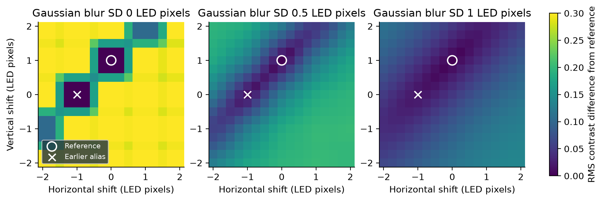
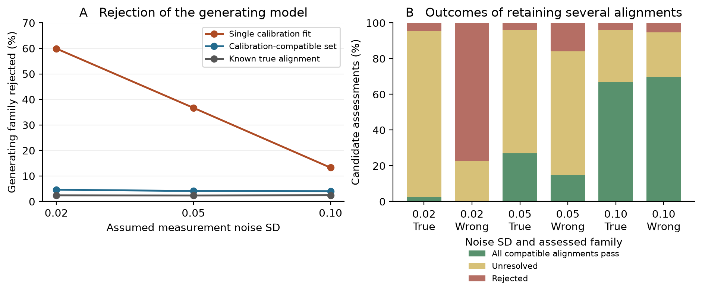

# Stimulus alignment and model assessment pilot V1

Completed 16 November 2026. This report accompanies the initial manuscript,
not a submission-ready or biologically validated result.

## Decision

**The pilot does not support a blur-robust exact-alignment ambiguity claim.**
Adding a Gaussian blur of SD 1 LED pixel leaves only one of the 289 sampled
alignments numerically equal to each of the six cells' reference inputs.
This is an input-space result under an assumed blur, not recovery of the
biological receptive-field centre from measured neural activity.

The known-truth spatial simulation illustrates a genuine assessment trade-off:
keeping several calibration-compatible alignments reduces rejection of the
generating model but often produces an unresolved answer and retains other
models. No improved calibration procedure, broad empirical prevalence, new
identifiability theory, neuronal degeneracy or full biological validation has
been established. These results are insufficient to claim a competitive new
method on their own.

## Archived-image audit

The earlier observation came from a project reanalysis of selected SingleBar
data in the [Gruntman et al. source study](https://doi.org/10.1038/s41593-017-0046-4).
Its Supplementary Figure 1 explicitly describes two-dimensional square-flash
mapping for all recorded cells. Therefore the selected bar files cannot be
treated as the entire original mapping record. The archived nominal grid
centres also exist, and the row/column coordinate conversion passes for all
six cells. The broader mapping responses were not acquired or analyzed here.
This reanalysis does not establish an omission or invalid model assessment by
the original authors.

All six already inspected cells 3–8 were included: 1,640 flash trials, 328
duration-by-position conditions and 82 distinct bright images. The source MAT
files match their pre-existing acquisition receipts. For cells 3–5, all 25
historical integer-shift input arrays reproduce exactly from the raw images
(maximum discrepancy zero). Six source cells are not six independent datasets.

We tested [-2,2]² LED-pixel shifts at quarter-pixel increments: 289 positions.
Zero blur reproduces the previous piecewise-constant LED convention. Nonzero
blur uses the analytic Gaussian integral over each LED square, with a neutral
background outside the display. SD 0.5 and 1.0 pixels correspond to Gaussian
FWHM 2.65° and 5.30°, because one LED pitch is 2.25°. These scales are sensitivity
assumptions, not measured optics in these animals.

| Author cell | Original integer reference aliases | Matching sampled shifts at SD 0 | At SD 0.5 | At SD 1.0 |
| --- | ---: | ---: | ---: | ---: |
| 3 | 5 | 51 | 9 | 1 |
| 4 | 2 | 18 | 1 | 1 |
| 5 | 2 | 18 | 1 | 1 |
| 6 | 5 | 51 | 9 | 1 |
| 7 | 2 | 18 | 1 | 1 |
| 8 | 1 | 6 | 1 | 1 |

Matching here means maximum contrast difference <=1e-12 over the saved spatial
input arrays. Counts at zero blur include fractional-coordinate plateaus of
the piecewise-constant sampler. They are not counts of distinguishable or
indistinguishable biological RFs. For the formerly identical alternatives of
cells 4, 5 and 7, RMS differences become approximately 0.0161 contrast at SD
0.5. For the farthest transverse alternatives of cells 3 and 6, they are only
about 0.00095 and 0.00093 at SD 1.0. We do not know whether these changes would
be resolvable in recorded voltages. No new cable simulation or optical refit
was performed. An explicit blur can overlap with spatial filtering already
absorbed into effective model parameters; this pilot does not determine whether
such double counting occurs in the cable. It does not qualify a replacement
preprocessing pipeline. [All sensitivities](../results/alignment_assessment_pilot_v1/input_audit.json).

## Controlled assessment

The separate synthetic example uses three positive, unit-integral spatial
filters: isotropic Gaussian, elongated Gaussian and two-lobe Gaussian mixture.
It is not a T4 voltage model. All 25 integer RF centres in [-2,2]² are enumerated
as truths, with three known noise SDs, three calibration/test repetitions and
200 independently generated data sets per truth/noise combination: 45,000 data
sets and 135,000 candidate-family assessments. The calibration consists of 11
vertical bars and the independent test of 25 single-LED patches.

The single-fit procedure chooses a calibration-optimal centre before testing.
The set procedure retains centres passing a known-noise absolute chi-square
calibration test and reports all-pass, all-fail or unresolved outcomes in an
independent test. Neither procedure fits model gains, test responses or noise.
The two 0.025 test levels imply a per-generating-model false-rejection bound
of 0.05 under these specified known-noise assumptions; this elementary bound
is not a new statistical method. The all-pass outcome is called support only
within this finite toy assessment, not evidence that the biological mechanism
has been identified.

The following R2 counts incorporate the numerical tie correction documented
below. Every row pools 15,000 generating-family assessments, balanced across
three model families and 25 centres.

| Noise SD | Single-fit rejects generating family | Set rejects generating family | Set unresolved | Oracle alignment rejects |
| --- | ---: | ---: | ---: | ---: |
| 0.02 | 8,989 (59.93%) | 692 (4.61%) | 13,938 (92.92%) | 363 (2.42%) |
| 0.05 | 5,506 (36.71%) | 618 (4.12%) | 10,348 (68.99%) | 355 (2.37%) |
| 0.10 | 1,990 (13.27%) | 607 (4.05%) | 4,362 (29.08%) | 370 (2.47%) |

The corresponding assessments of *other* generating mechanisms also matter:
each row below contains 30,000 wrong-family assessments. A model that is not
rejected need not be correct.

| Noise SD | Wrong family not rejected by set | Wrong family passes at every retained alignment |
| --- | ---: | ---: |
| 0.02 | 6,793 (22.64%) | 109 (0.36%) |
| 0.05 | 25,234 (84.11%) | 4,439 (14.80%) |
| 0.10 | 28,392 (94.64%) | 20,927 (69.76%) |

Thus fewer rejections are not evidence for superior mechanism discrimination.
These noise scales are synthetic response units and cannot be compared directly
with the raw-image RMS contrasts above. No empirical error rates in real T4
recordings follow. [R2 results](../results/alignment_assessment_pilot_v1/numerical_ties_r2/synthetic_results.json),
[aggregate evidence](../results/alignment_assessment_pilot_v1/pilot_summary.json).

## Numerical correction and review

The first independent reviewer used the squared-distance matrix identity and
did not reproduce one single-fit count: 3,866 rather than the original 3,877.
Almost equal calibration errors made the exact floating-point argmin unstable.
Its code, failure and original results are preserved. The
[R2 amendment](ALIGNMENT_ASSESSMENT_NUMERICAL_TIES_R2.md), fixed before repeating
the synthetic run, selects the first lexicographic candidate within 1e-9
chi-square units of the minimum. It changes seven single-fit summary rows;
all compatibility-set and oracle counts are unchanged. For the correct-family
aggregate at noise 0.02, single-fit rejection changes from 9,009 to 8,989 of
15,000; the substantive conclusion is unchanged. This is an explicit
post-outcome numerical correction, not a fresh prospective result.

The R2 independent review verifies all 27 summary count rows over 135,000
candidate-family assessments and checks 810 scalar image samples using a
separate Gaussian integration implementation. Maximum scalar contrast error
is 1.11e-16; example statistical discrepancies are <=3.42e-13 chi-square units.
The original 31-file science lock still matches. Eight focused tests pass,
including two checks that numerical tie handling cannot use test outcomes.
[Review](../results/alignment_assessment_pilot_v1/numerical_ties_r2/independent_review.json),
[correction comparison](../results/alignment_assessment_pilot_v1/numerical_ties_r2/correction_comparison.json),
[initial failure](../results/alignment_assessment_pilot_v1/review_failure_v1/failure.json).

## Resources and disposition

The image audit took 4.70 process CPU seconds and peaked at 579,928,064 bytes
RSS; the initial synthetic stage took 1.37 CPU seconds and peaked at
112,427,008 bytes RSS. Each stage was a single process, but these two independent
stages were launched concurrently, an execution deviation from the protocol's
one-process wording. A combined instantaneous RSS measurement was not retained.
The corrected synthetic stage and review were separate later processes. The
reported numerical/scientific methods were unchanged by concurrency. Retained
science arrays are compact; no movies, new raw recordings or NEURON runs were
generated. The laptop suspended after the scientific stages and figures
completed; source locks were rechecked on resumption before authoring.

The stopping condition for the proposed exact-ambiguity argument is reached.
The current initial manuscript is an honest pilot and limitation analysis.
Further work would need an independently justified optical/response observation
model, use of full original mapping information where available, comparison
against existing uncertainty-aware methods, and a demonstrably useful new
calibration design. None of those additional achievements is claimed here.
