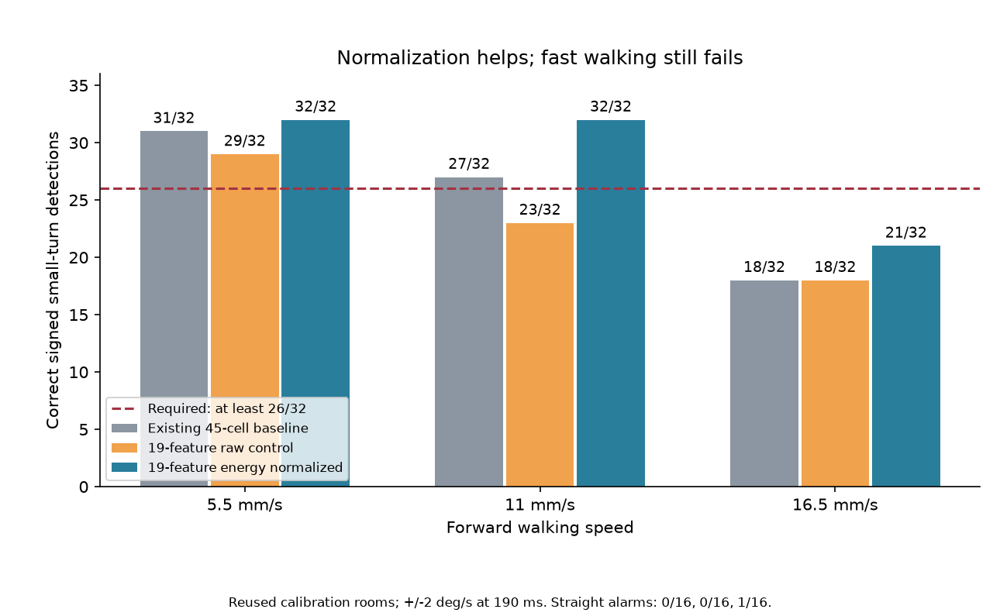

# Bilateral neural energy normalization pilot V1

2026-11-01. **Completed bounded development experiment; small-turn target not met.**

The user's external review motivated a cheap test of whether normalization and
room-level selection could rescue our existing neural representation. The new
readout improves small-turn detections to **32/32, 32/32 and 21/32** at walking
speeds 5.5, 11 and 16.5 mm/s, respectively. Fast walking still fails the unchanged
requirement of at least 26/32 detections and at least 13/16 in each direction.
This is progress on reused development rooms, not fresh validation or a finished
neural model. No frontend, graph, synapse or physiological parameter was changed.

## What was actually executed

The [pre-outcome protocol](BILATERAL_ENERGY_PILOT_PROTOCOL_V1.md),
[configuration](../configs/bilateral_energy_pilot_v1.json) and
[implementation](../scripts/bilateral_energy_pilot_v1.py) were hash-frozen before
new fits in [before_fit.json](../results/bilateral_energy_pilot_v1/before_fit.json).
The pilot loaded and verified **496 existing observation files**: 240 zero/+/-2
training episodes in 24 p rooms and 256 zero/+/-2/+/-5 calibration episodes in 16
w rooms. It rendered **zero frames** and ran **zero neural simulations**. Old test
populations and reserved st rooms were not accessed.

The fixed 19-dimensional readout combines seven downstream right-minus-left
role means and twelve right-minus-left horizontal T4/T5 source-bin features.
The original 100-ms mean minus a 200-ms-earlier mean supplies the causal change
signal. This is a constraint on an artificial readout, not a claim that the
connectome is symmetric or candidate cells have individually verified homology.

The bilateral energy estimate is a causal 200-ms mean of nonnegative horizontal
T4/T5 bin activity, summing both directions rather than assuming one channel
means forward walking in both eye coordinate systems. It is a neural proxy, not
true speed or depth. The inference score is

`q(t) = gain * raw_linear_numerator(t) / [floor + (E(t)/Eref)^gamma]`.

The numerator is held fixed across normalizations at a given ridge value. A
training-only positive gain sets degree/s-equivalent regression units. Actual
walking speed, yaw labels, scene identity, paired straight episodes and future
frames never enter inference. Labels enter training and evaluation only.

Leave-one-room-out training selection compared five ridge values, four fixed
normalizations, and five raw controls: **25 training configurations**, followed
by a single calibration pass of the selected normalized score and controls.
Ridge uses summed episode-equivalent losses; the grid is not silently applied
to a unit-total mean loss. Selection maximizes minimum signed detection over
speed/direction groups, then total detection, then minimizes balanced MSE.
This is hyperparameter selection inside training, not an unbiased nested-CV
performance estimate. Full rules and tie ordering are in the protocol.

Both raw and normalized selections use ridge 1. The selected normalized model
has **gamma 1, floor 1 and Eref 0.0008167658904743606**. Its training-only gain is
1.8057160999651032. The raw control's gain is 1.0025549998839502. Constant gain
changes do not account for detection differences because each common cutoff
is calibrated from that score's negative episodes. The same-lambda raw control
and independently selected raw control happen to be identical here.

The selected normalized candidate's out-of-fold training results were 48/48,
48/48 and 39/48 small-turn detections; the fast signed split was 22/24 and
17/24. These selection statistics already expose a remaining directional
weakness; they are not independent evidence of generalization. [All training
comparisons](../results/bilateral_energy_pilot_v1/training_selection.json).
The [model/selection freeze](../results/bilateral_energy_pilot_v1/before_calibration.json)
was saved before any new calibration score was computed.

## Calibration outcomes

All small-turn values below are joint detection **and correct sign** at 190 ms
after yaw onset. Straight episodes use their maximum alarm over the full
two-second monitoring interval; that harder negative requirement was retained.
The new score cutoffs use negative episodes only and permit at most one alarm
in 16 at any speed/static condition. Positive calibration trials select nothing.

| Fixed readout | Slow +/-2, /32 | Medium +/-2, /32 | Fast +/-2, /32 | Straight alarms slow/medium/fast, /16 |
|---|---:|---:|---:|---|
| Original 45-cell episode90 baseline | 31 | 27 | 18 | 0 / 0 / 1 |
| New 19-feature raw control | 29 | 23 | 18 | 0 / 0 / 1 |
| New normalized 19-feature score | **32** | **32** | **21** | **0 / 0 / 1** |
| Required | >=26 | >=26 | >=26 | <=1 at each speed |

The original baseline retains its exact coefficients and cutoff
**1.6219391228674396**. All 256 primary endpoint scores reproduce its earlier
calibration values exactly, including the stronger 18/32 fast result highlighted
by the external review. This avoids comparing only against the weaker latest
round. The original model was trained on a different label mixture (+/-5 was
included), so comparisons against it are descriptive, not an isolated
normalization intervention. The matched 19-feature control supplies that control.

The raw cutoff is **1.6422408173634429**; the normalized cutoff is
**1.2011816635353811**. All methods detect **32/32 at +/-5 deg/s at each speed**
and produce **zero stationary alarms**. The new scores are identically zero
at rest. The old baseline has a small intercept-driven stationary score
0.0291653, below its original threshold.

At fast speed, normalized -2 detections are **12/16** and +2 detections **9/16**;
both miss the required 13/16. All actual +/-2 turns have the correct raw score
sign at every speed, but eleven fast turns fall below the alarm threshold.
Correct sign conditional on a real turn does not establish reliable turn
detection, because inference must also reject straight walking.

The normalized fast false-alarm episode is **w13**, whose straight peak is
1.274004782. Other straight peaks set the minimum allowed common cutoff to
1.201181664. Missed turn scores range from absolute 0.3517 to 1.1601. Lowering
the threshold therefore trades misses for excess straight-walking alarms;
the frozen threshold rule was not changed after seeing this overlap.



[Complete results, including every episode endpoint and negative peak](../results/bilateral_energy_pilot_v1/calibration_results.json),
[all full score curves](../results/bilateral_energy_pilot_v1/calibration_score_curves.npz),
[selected coefficients](../results/bilateral_energy_pilot_v1/models.json).

## What the diagnostic does and does not explain

Normalization helps this fixed numerator: compared with its matched raw control,
correct small turns increase by **3, 9 and 3** across increasing speeds, with the
same counts of false alarms. The false-alarm rooms can differ. This is a
finite development comparison, not a population-level significance claim.

Median energy during straight walking increases from 0.0004155 to 0.0007768 to
0.0010620. This supports its use as a motion-energy proxy in these scenes, but
energy varies with environment and does not uniquely measure walking speed.
After normalization, median negative episode peaks are still 0.3670, 0.5757 and
0.8017, while the standard deviations of all straight callback scores are
0.1442, 0.2514 and 0.3838. Speed-related clutter variation was reduced relative
to the turn score, but was not eliminated.

The explicitly nondeployable paired-straight diagnostic shows mean signed
turn increments 2.4006, 1.7653 and 1.3411; even the minimum signed increment is
positive at each speed (fast minimum 1.0666). Thus this fixed score responds
consistently to adding yaw when a same-room straight reference is provided.
That reference is unavailable at inference. This diagnostic is not a detection
algorithm, an information ceiling, or proof that any decoder can meet the task.

These results support **incomplete nuisance rejection** in this readout as the
operational failure. They do not identify a unique faulty synapse, prove that
spatial pooling is the sole cause, demonstrate missing biological connections,
or show that all neural models must fail. The external review's claim that
encoder training is already falsified is stronger than the evidence. Similarly,
its v-squared clutter argument is an approximation to linear geometric flow,
not an established universal scaling law of these neural responses.

## Verification, failures and resource use

Four focused synthetic tests pass: causal literal windows, grouped antisymmetry
and symmetric energy, episode-budget threshold ties, and excluded-room fitting
invariance. All **192 calibration turn/straight population prefixes** match
bitwise before yaw onset. The three new model scores give **576 bitwise-matching
pre-onset score comparisons**. Literal endpoint feature arithmetic agrees within
5.51e-18. An independent implementation groups cells first, uses direct
convolution windows rather than cumulative sums, and scores with einsum.
It reproduces **1,024 full score curves / 147,968 callback scores** within
**2.11e-13**, checks all 24 speed/magnitude gates, verifies selection ordering,
and passes **510 input/source hash checks**. It does not independently refit the
training bank. [Independent review receipt](../results/bilateral_energy_pilot_v1/independent_review.json).

The first and second independent-review scripts failed before score comparison
because NumPy advanced indexing reordered the source-feature axes. Both original
sources and tracebacks remain preserved. R3 uses explicit `np.take` on the
channel axis, checks the intended shape, and passes. This correction changes
only the independent reviewer. The pre-outcome fitted implementation,
configuration, selected coefficients, scores and criteria remain unchanged.
[R1 failure](../results/bilateral_energy_pilot_v1/independent_review.log),
[R2 failure](../results/bilateral_energy_pilot_v1/independent_review_r2.log),
[successful R3](../scripts/review_bilateral_energy_pilot_r3.py).

The complete bounded fit/calibration invocation took **3.233 seconds** and
**74,088,448 bytes peak RSS**, using one CPU and zero GPUs. The independent
score/hash review took **1.167 seconds** separately. Coding, documentation,
figuring and review time are additional; these CPU numbers are not a claim
about total assistant usage. Final package size is recorded in the independent
post-sealing receipt and must remain below 2,000,000 bytes.

No full numerical-refinement qualification was run because the normalized
candidate failed the prior calibration gate. Arithmetic reproduction is not
solver/spatial/temporal convergence and cannot replace it. The planned full
81 cached numerical refinements and any fresh-room testing were therefore
not triggered. No new physiological benchmark was attempted.

## Decision and next distinct option

**Stop this pilot as predeclared.** It provides a modest improvement, not a
working solution for the original fast-walking small-turn target. Do not launch
more normalized-readout variants on the same 429-column archive in this study,
relabel reused w rooms as held-out validation, or lower the acceptance criteria.

The next distinct option is a separately budgeted **local nonlinear subunit
readout of unbinned neural activity before global pooling**. This must differ
from the already failed source-interpolated geometric weighted medians in the
[sequential repairs report](SEQUENTIAL_SMALL_TURN_REPAIRS_REPORT_V1.md): do not
again assume channel amplitude is an accurate local angular velocity. First
audit whether actual neuron-rate traces at the required callbacks are cached,
and the cost of one known-room replay if they are not. Only then define a small
prospective prototype. It is an artificial neural-decoding hypothesis, not an
anatomical discovery or a guaranteed fix. Encoder training remains a more
expensive conditional alternative; nothing here proves it impossible.

## Reproduce and inspect

Use the local scientific interpreter, without importing Torch or FlyVis:

```bash
PYTHONDONTWRITEBYTECODE=1 <HOME>/Lab/mech_male_fly_cns/.venv/bin/python -m unittest discover -s tests -p test_bilateral_energy_pilot_v1.py -v
PYTHONDONTWRITEBYTECODE=1 <HOME>/Lab/mech_male_fly_cns/.venv/bin/python scripts/review_bilateral_energy_pilot_r3.py
```

The original execution used `scripts/bilateral_energy_pilot_v1.py prepare`
followed by `... run`. Both stages deliberately refuse to overwrite an existing
study/fit. A full refit requires an isolated checkout/output directory with
the same source datasets; preserve the current sealed result. The exact
runtime versions are in [decision.json](../results/bilateral_energy_pilot_v1/decision.json).
The completion archive contains exact source copies, the user-provided review,
and a dated progress snapshot. Live progress and AGENTS stay outside its index.

## Undergraduate explanation / TL;DR

We want the fly's neural model to notice a gentle turn without falsely calling
straight walking a turn. We reused saved neural responses and divided the turn
signal by an estimate of how much the scene was moving. This helped: detection
was perfect in the slower walking conditions, but only 21 of 32 fast-walking
turns were detected. We need at least 26. Changing scenery still overlaps the
small-turn signal. The useful next question is whether local neural signals
can be combined before wide-field averaging loses useful spatial detail.
This round was cheap and preserved all earlier results; the small-turn solution
and biological validation remain unfinished.
