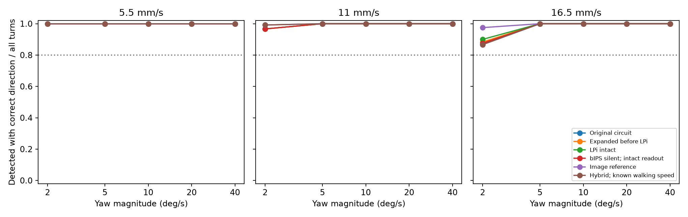

# Final open-loop interpretation and figure correction R2

2026-10-30. This is a **post-outcome explanation and reporting correction** to the [sealed V1 report](FINAL_OPENLOOP_MILESTONE_REPORT_V1.md). No model, condition, fitted readout, criterion, result or verdict changes. The original figure and report remain preserved.

We wanted a brain-model signal that distinguishes a small turn from ordinary forward walking, and evidence that bIPS helps. We completed 2,424 new binocular-image episodes in 84 generated rooms, with 60 rooms reserved for final testing, ten circuit copies, fixed training-only external readouts, numerical controls and four deterministic replays. The model provides a strong small-turn signal, but its external detector still mistakes some straight-walking visual changes for turns.

At 2 deg/s, the intact LPi/DNp15 readout correctly detected the turn and its direction in **120/120, 116/120 and 108/120** cases at 5.5, 11 and 16.5 mm/s. At 5 deg/s it achieved 120/120 at every speed. Straight-walking episodes with any alarm over two seconds were **0/60, 6/60 and 36/60**, respectively; the limit was 6/60. These are observed deterministic room counts, not reliability estimates for live flies. The fastest-speed false alarms alone fail the complete empirical target. A favorable endpoint false-alarm count (2/60 at that speed) does not remove alarms elsewhere in the monitoring window.

The sealed V1 plot used automatic logarithmic tick labels that overlap. R2 uses explicit ticks at the same five tested magnitudes, with unchanged curves and a separate source-row CSV. Neither plot alone shows that the full detector passes; the false-alarm controls are required.

The circuit interventions do **not** demonstrate a robust bIPS improvement. With the intact readout kept fixed, bIPS silence leaves detection unchanged in five of six primary speed/magnitude conditions and lowers it by 3/120 in the remaining one; every paired detection interval includes zero. Silence lowers straight-episode alarm counts from 6 to 1 at 11 mm/s and from 36 to 28 at 16.5 mm/s, while the fastest condition still fails. This is a detection/false-alarm tradeoff within the model, not evidence that real bIPS is unnecessary. HS silence has the much larger detection effect, including with its own separately training-fitted readout; H2 silence has comparatively small effects in this assay. No decoder was retrained on final test data.

| Circuit / readout | Speed mm/s | Correct 2 deg/s turns /120 | Straight episodes with any alarm /60 |
|---|---|---|---|
| LPi_intact/dnp15/own | 5.5 | 120 | 0 |
| LPi_intact/dnp15/own | 11.0 | 116 | 6 |
| LPi_intact/dnp15/own | 16.5 | 108 | 36 |
| LPi_bIPS_silent/dnp15/fixed | 5.5 | 120 | 0 |
| LPi_bIPS_silent/dnp15/fixed | 11.0 | 116 | 1 |
| LPi_bIPS_silent/dnp15/fixed | 16.5 | 105 | 28 |
| LPi_bIPS_silent/dnp15/own | 5.5 | 120 | 0 |
| LPi_bIPS_silent/dnp15/own | 11.0 | 117 | 5 |
| LPi_bIPS_silent/dnp15/own | 16.5 | 109 | 33 |
| LPi_HS_silent/dnp15/fixed | 5.5 | 0 | 0 |
| LPi_HS_silent/dnp15/fixed | 11.0 | 0 | 0 |
| LPi_HS_silent/dnp15/fixed | 16.5 | 0 | 0 |
| LPi_HS_silent/dnp15/own | 5.5 | 1 | 26 |
| LPi_HS_silent/dnp15/own | 11.0 | 5 | 57 |
| LPi_HS_silent/dnp15/own | 16.5 | 17 | 59 |
| LPi_H2_silent/dnp15/fixed | 5.5 | 120 | 0 |
| LPi_H2_silent/dnp15/fixed | 11.0 | 117 | 6 |
| LPi_H2_silent/dnp15/fixed | 16.5 | 109 | 31 |

These are controlled effects within the frozen model. The original graph, missing electrical coupling, uncertain recurrent-family identities and functional T4/T5 surrogate limit biological interpretation. Both new anatomy and stimulus/readout choices can matter; this experiment does not identify a single biological cause of the false alarms.

The frozen numerical rule aggregated every circuit/readout, so its failure must not automatically be described as a DNp15 solver failure. All 27 solver-refinement cases passed, with maximum saved-state difference below 1.21e-10. Across all readouts, 13 spatial cases and one temporal case failed score/decision criteria. The following post-outcome localization reproduces all 81 sealed maximum-score and flip summaries and separately identifies the primary LPi/DNp15 sensitivity. It cannot replace or relax the original failed numerical gate.

| Scope | Refinement | Failed cases /27 | Decision flips | Maximum score change |
|---|---|---|---|---|
| all_readouts | spatial | 13 | 19 | 0.398631 |
| all_readouts | temporal | 1 | 1 | 0.140651 |
| all_readouts | solver | 0 | 0 | 7.10248e-09 |
| LPi_intact_DNp15 | spatial | 0 | 0 | 0.156052 |
| LPi_intact_DNp15 | temporal | 0 | 0 | 0.0624515 |
| LPi_intact_DNp15 | solver | 0 | 0 | 2.8422e-09 |

The [full technical report](FINAL_OPENLOOP_MILESTONE_REPORT_V1.md), [professor brief](FINAL_OPENLOOP_PROFESSOR_BRIEF_V1.md), [sealed integrity receipt](../results/final_openloop_milestone_v1/post_exit_integrity_v1.json), [paired ablation evidence](../results/final_openloop_milestone_v1/analysis/ablation_effects.csv) and [numerical localization](../results/final_openloop_release_review_r2/numerical_localization.json) preserve the complete evidence. Independent checks reconstructed all 156,168 calibration/test scores and decisions; numerical reproducibility does not establish physiological validity.

In undergraduate terms: we have completed a fair test and found that the model notices small turns well, but sometimes raises an alarm while the fly is still walking straight, especially at higher speed. We have not shown that bIPS reliably solves this problem. That tells us what still needs explaining, rather than treating a working simulation as a fully validated fly brain. The research package is complete; the full reliable-detector target failed, and biological validation remains unestablished. The next biological stage is a separately frozen, stimulus-matched physiological benchmark after the published data and measurement details are audited. Further engineering changes would require a new study; V1 stays closed.
