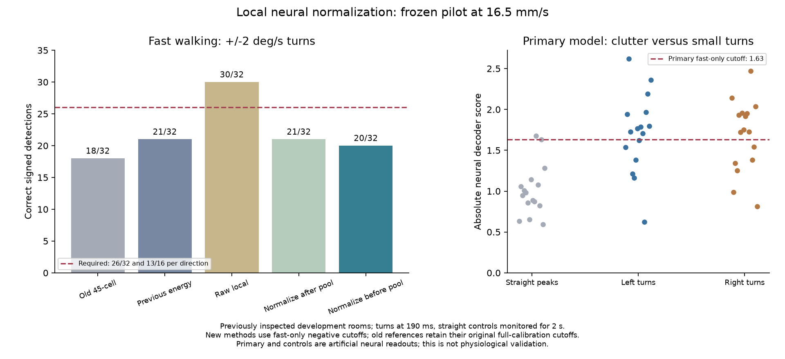

# Local neural-subunit pilot V1

2026-11-02. **The primary normalization hypothesis fails its frozen fast-walking
gate. The matched raw control passes this necessary development gate and is a
promising, separately identifiable follow-up candidate; it is not qualified.**
No frontend, graph or numerical parameter changed. Source checkpoint: `a2360f7`.

## Design and provenance

The [prospective protocol](LOCAL_SUBUNIT_PILOT_PROTOCOL_V1.md) and
[pre-feature freeze](../results/local_subunit_pilot_v1/before_features.json)
define one primary decoder and two matched controls, fixed ridge 10, causal
100-ms averaging minus the same signal 200 ms earlier, and no parameter search.
Individual rates are observed from the existing 13,624-cell LPi-intact model.
The artificial readouts use 48 bilateral local T4/T5 features plus seven
downstream role differences. They are not anatomical additions to the graph.

There are 2,911 co-located a/b pairs among 3,347 anchors (87.0% coverage).
The fixed tolerance is 0.001 degrees in the project's functional visual-field
registration. Left T4/T5 coverage is 719/835 and 726/825; right coverage is
735/849 and 731/838. Nine of 96 eye/family/patch groups are empty. Unmatched
anchors are excluded by geometry; this is a limitation, not an inferred missing
synapse. The shared training-only normalization floor is 0.0019428676176511772.
[Full mapping/coverage](../results/local_subunit_pilot_v1/map_coverage.json).

Training uses all 24 p rooms, all speeds, static/straight negatives and +/-2
positives: 240 episodes. The three models fit once on 19,344 weighted samples;
coefficients are [frozen before w extraction](../results/local_subunit_pilot_v1/before_calibration.json).
Fast calibration uses 16 previously inspected w rooms at 16.5 mm/s: 80 episodes
covering zero, +/-2 and +/-5. It is development data, not new validation.

## Results

| Readout | +/-2 joint correct /32 | Negative /16 | Positive /16 | Straight alarms /16 | +/-5 correct /32 | Fast cutoff |
|---|---:|---:|---:|---:|---:|---:|
| Primary: normalize before pooling | 20 | 10 | 10 | 1 | 32 | 1.630377 |
| Control: normalize after pooling | 21 | 11 | 10 | 1 | 32 | 1.505215 |
| Control: raw local features | **30** | **16** | **14** | **1** | **32** | **1.039200** |
| Original 45-cell episode90 reference | 18 | 10 | 8 | 1 | 32 | 1.621939 |
| Previous bilateral-energy reference | 21 | 12 | 9 | 1 | 32 | 1.201182 |

Each new model's provisional cutoff uses fast straight-negative episode peaks
only, allowing one alarm among 16, with a strict threshold. The old references
retain their original full-calibration cutoffs. The provisional cutoff is the
lowest possible common cutoff consistent with the fast false-alarm rule; failure
here rules out full qualification for the primary. A fast pass does not establish
the eventual cross-speed cutoff. All five models have correct raw signs on all
32 small turns; misses are below-threshold endpoints. Larger +/-5 turns pass
for all five. [Complete results](../results/local_subunit_pilot_v1/fast_calibration_results.json),
[all score curves](../results/local_subunit_pilot_v1/fast_calibration_score_curves.npz).



The primary must have >=26/32 joint detections AND >=13/16 per sign. It fails
both requirements. Applying the local ratio before pooling gives no improvement
over its after-pooling control on these rooms. Raw local features perform better
descriptively. This does not establish that all nonlinear local readouts fail,
that all useful information was lost by old pooling, or that the raw control
will generalize. Its feature selection differs from the original 45-cell and
19-feature references, so those comparisons cannot uniquely identify a mechanism.

## Numerical reproduction, independent arithmetic and resources

All 320 training/fast-calibration observations reproduce original source-drive
hashes, re-pooled rates, full-state checkpoints and final states. Streamed
negative image hashes also match the archived summaries. For matching w turn
and straight episodes, all 64 pre-onset full-rate prefixes and all 192 readout
score prefixes agree bitwise. Exposing individual rates changes observation,
not circuit dynamics. This is reproduction, not new convergence evidence.

Three focused pre-freeze unit tests pass. An independent reviewer verifies all
2,911 mapped pairs and the training floor; replays w00 straight and both +/-2
turns; reproduces 78,540 feature values using literal local windows and loops
(maximum difference 3.32e-14), 32,640 saved callback scores using independent
einsum arithmetic (maximum 1.78e-15), and all six new-method group gates.
The literal replay scores differ by at most 1.51e-14. Neither models nor gains
are independently refit. [Independent review](../results/local_subunit_pilot_v1/independent_review.json).

Observation CPU is 2,070.07685 seconds. The three independent replay observations
add 16.55068 seconds: total **2,086.62753 seconds (34.78 CPU minutes)**, below
3,600. Worker peak RSS is 261,341,184 bytes. Training extraction wall time is
428.14 seconds; fast extraction 114.15 seconds; fitting 0.423 seconds; independent
review 19.87 seconds. Computation timings do not measure assistant usage or code
development time. Four one-thread CPU workers; no GPU. Compact study payload
before figures/report/archive is approximately 48 MB, below 512 MiB. Full rates
and images are not saved. There are 208 cached positive-input replays and 112
streamed negative episodes in the main extraction, plus the feasibility replay
and three independent checks. Source arrays and historical results are intact.

An initial read-only geometry inspection omitted PYTHONPATH and failed import;
the same inspection succeeded with PYTHONPATH=src. The error/correction is
preserved in `initial_environment_failure.json`. There were no study simulation,
hash-parity, fit, or independent-review failures.

## Decision, limitations and next alternative

**Close this pilot as a negative primary result.** Its remaining-calibration
directory stays empty. No numerical-refinement bank, reserved-room test, encoder
training or control promotion occurs inside this pilot. The original frozen
criteria and negative decision remain unchanged.

The unexpected raw-control result is evidence to reconsider the earlier plan
to abandon this readout family immediately after a normalization failure. A
separately versioned qualification study can nominate that exact raw model
retrospectively, explicitly identify this selection, and freeze all weights,
features and acceptance rules before any further evaluation. It must pass full
cross-speed calibration, all numerical refinements and untouched environments;
no favorable control may be relabeled as this pilot's primary success. No
additional fitting or hypothesis bank is justified by this one result.

The readout directly uses T4/T5 as well as downstream activity. Even a qualified
decoder would not demonstrate that the biological bIPS/DNp15 pathway implements
it or that bIPS improves biological yaw detection. The functional direction
routing, incomplete upstream physiology and missing justified electrical
coupling remain. Existing [HS voltage](HS_VOLTAGE_BENCHMARK_REPORT_V1.md) and
[H2 direction-tuning](H2_FROZEN_MODEL_BENCHMARK_REPORT_V2.md) comparisons are scoped
and incomplete physiological evidence, not validation of this readout. No new
biological experiment or recording comparison was performed in this pilot.

## Reproduction

The preserved new script stages are `prepare`, `training`, `fit`,
`fast_calibration`, and `assess_fast`. Original results are exclusive-write and
must not be overwritten; a fresh execution needs an isolated output namespace
and the retained indexed inputs. These are not instructions to regenerate the
retired historical movie archive. Repeatable read-only checks after sealing:

```bash
PYTHONDONTWRITEBYTECODE=1 OPENBLAS_NUM_THREADS=1 PYTHONPATH=src <HOME>/Lab/mech_male_fly_cns/.venv/bin/python -m unittest discover -s tests -p test_local_subunit_v1.py -v
PYTHONDONTWRITEBYTECODE=1 <HOME>/Lab/mech_male_fly_cns/.venv/bin/python scripts/finish_local_subunit_pilot_v1.py audit
```

## Undergraduate explanation

We want the neural model to notice a gentle turn without confusing it with the
moving scenery during straight walking. We tested whether adjusting small local
signals before averaging would help. That adjustment failed. The simpler
comparison, using the same local signals without the adjustment, detected 30 of
32 fast-walking turns and produced one false alarm in 16 straight walks. This
is a useful lead, not a finished solution: we still need other speeds, numerical
checks and genuinely new environments. We preserve the failed prediction because
it tells us that adding this normalization was not the helpful ingredient.
