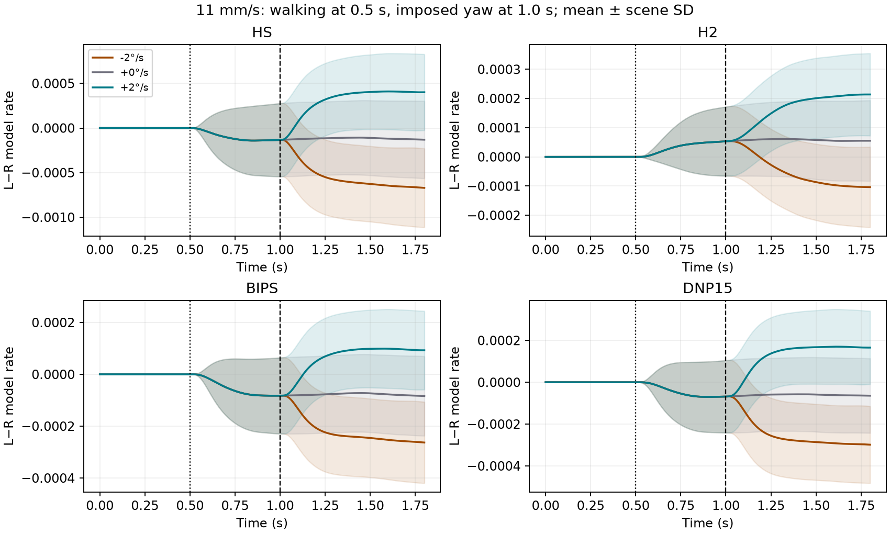

# Small yaw onset during established walking, V1

Completed 2026-10-27. Frozen inference/protocol checkpoint: `0b460a7`.

**The fixed engineering reference detects small imposed turns during ongoing
walking within the declared 200-ms deadline. The original MaleCNS DNp15
readout does not meet the reliability target. Neural responses do change with
yaw direction, so this is not evidence of absent neural sensitivity.** Legacy
decoder transfer and temporal-sampling sensitivity limit interpretation of the
neural classification results. No model or readout was tuned.

## One fixed question and experiment

The preceding [causal detector study](CAUSAL_SHORT_WINDOW_YAW_REPORT_V1.md)
started walking and yaw together. Here, forward walking begins at 0.5 s and
imposed yaw begins at 1.0 s. Body-forward speed remains constant. Both visual
pipelines and the neural state run continuously from t=0; nothing resets at
the yaw event. Position and heading follow exact piecewise SE(2) kinematics.
This is an idealized yaw-velocity step, not a gait/body dynamics simulation.

Use 24 new seed-disjoint rooms from the same textured-room/clutter family,
balanced empty/three-sphere scenes. Each has 15 moving conditions (three
speeds crossed with 0, ±2, ±5 degrees/s) and a stationary control: **384 fresh
episodes**. All model comparisons within an episode use identical binocular
retinal images. Preserve the original 1-degree grid, 2-mm height, 0.3-mm
binocular baseline, frontend parameters, graph and neural parameters.
[Protocol](ONGOING_WALKING_YAW_PROTOCOL_V1.md), [configuration](../configs/ongoing_walking_yaw_v1.json),
[plans](../results/ongoing_walking_yaw_v1/plans.json),
[seed audit](../results/ongoing_walking_yaw_v1/seed_audit.json).

The original HRC frontend drives the original intact MaleCNS network. The
comparison reference is the unchanged backward-current, confidence-weighted,
registered engineering detector, with its 100-ms averaging window and
1-degree/s cutoff. It uses image-derived local motion and conditioning cues;
it is not biological T4/T5 activity or an output of the MaleCNS graph. The
comparison includes different encoding and integration, and cannot locate a
performance gap uniquely in downstream connectivity.

The primary deadline is **200 ms after yaw onset**. Both systems use the ten
response samples in [1.10,1.20), through 1.19 s; future images do not enter
that score. Also retain [0.90,1.00) pre-event responses and [1.10,1.80) late
700-ms means. The latter is a diagnostic, not an optimized replacement for
the primary interval. No speed/window optimization or controller is included.

## Frozen neural scoring and its boundary

Apply the 12 previously calibrated role/speed readouts for HS, H2, bIPS and
DNp15 unchanged. DNp15 is the primary neural readout; other groups are fixed
secondary outcomes. The readouts use bilateral mean model rates and their
original coefficients, centers, scales and thresholds. Speed conditioning is
supplied by the experiment, not inferred by a unified speed-independent decoder.
[Readouts and provenance](../results/ongoing_walking_yaw_v1/frozen_neural_readouts.json).

These classifiers were calibrated on longer simultaneous-onset episodes.
Using them here is a frozen-readout transfer test. Failure can reflect the
decoder/representation/context as well as circuit properties; it does not
demonstrate that no yaw information exists in the population. Stationary
neural trajectories are checked directly and left unclassified because no
stationary neural calibration exists. The engineering stationary scores are zero.

The historical task bar is unchanged: >=80% detected turns, >=80% raw-sign
accuracy including undetected turns, <=10% observed straight alarms at every
speed, at ±2 and sustained at ±5 degrees/s. For 24 rooms, require >=39/48
detections, >=39/48 raw correct signs and <=2/24 straight alarms. Undefined
walking outputs fail; none occurred. [Pre-development freeze](../results/ongoing_walking_yaw_v1/before_development.json),
[pre-fresh-test freeze](../results/ongoing_walking_yaw_v1/before_test.json).

## Primary small-turn result

| System | Speed (mm/s) | ±2°/s detected | Correct raw direction | Straight alarms | Behavioral target |
|---|---:|---:|---:|---:|---|
| Frozen DNp15 readout | 5.5 | 7/48 | 40/48 | 1/24 | Fail |
| Frozen DNp15 readout | 11 | 6/48 | 31/48 | 3/24 | Fail |
| Frozen DNp15 readout | 16.5 | 6/48 | 29/48 | 3/24 | Fail |
| Fixed engineering reference | 5.5 | 48/48 | 48/48 | 0/24 | Pass |
| Fixed engineering reference | 11 | 47/48 | 48/48 | 0/24 | Pass |
| Fixed engineering reference | 16.5 | 47/48 | 48/48 | 1/24 | Pass |

Joint detected-and-correct DNp15 counts are 7/48, 5/48 and 4/48. Thus some
medium/fast detections have the wrong direction. Every detected reference
turn has the correct direction. At ±5 degrees/s the reference detects and
correctly signs 48/48 at every speed; DNp15 detects 32/48, 7/48 and 6/48.
Straight controls are shared between magnitudes, not independent extra trials.

Reference mistakes are retained: p13's -2-degree/s scores are -0.90996 at
11 mm/s and -0.38863 at 16.5 mm/s, below the fixed detection magnitude. Its
fast straight score is +1.78709 degrees/s, causing the reference's one alarm.
No threshold or scene-specific correction was applied.

[PDF](../results/ongoing_walking_yaw_v1/figures/primary_comparison.pdf),
[all 60 capability curves](../results/ongoing_walking_yaw_v1/analysis/curves.csv),
[all 5,760 phase/feature rows](../results/ongoing_walking_yaw_v1/analysis/predictions.json).
The latter include pre-event rows and explicitly unclassified stationary neural
rows; not every row is a separate evaluated turn detection.

## Other groups and the late diagnostic

| Frozen neural readout | ±2 detections at 5.5/11/16.5 mm/s | Raw signs correct | Straight alarms |
|---|---|---|---|
| HS | 9/3/3 of 48 | 37/27/28 of 48 | 0/3/1 of 24 |
| H2 | 6/11/7 of 48 | 34/26/26 of 48 | 2/6/3 of 24 |
| bIPS | 10/5/7 of 48 | 39/27/26 of 48 | 2/2/4 of 24 |
| DNp15 | 7/6/6 of 48 | 40/31/29 of 48 | 1/3/3 of 24 |

No frozen neural role readout qualifies across the tested conditions. In the
late 700-ms interval, DNp15 ±2 detections are 16/48, 7/48 and 8/48, still
below the target. Its slow ±5 result passes (46/48 detected, 48/48 signs,
2/24 alarms), but medium/fast cases do not. The reference's late ±2 counts
are 48/48, 48/48 and 47/48 with 0/24, 0/24 and 1/24 alarms. Longer averaging
therefore does not make this frozen DNp15 readout qualify on the small-turn task.

Before yaw onset, DNp15 already alarms in 1/24 straight rooms at each speed;
the reference alarms in 0/24, 1/24 and 1/24. Only one representative
straight-assigned row per room/speed is counted here: pre-event prefixes are
identical across future yaw assignments. Pre-event labels must not be treated
as if the future turn were already present. [Pre-event scores](../results/ongoing_walking_yaw_v1/analysis/pre_event_scores.json).

## Neural sensitivity is present

At 11 mm/s the raw HS/H2/bIPS/DNp15 left-minus-right trajectories separate
after the imposed yaw event. Bands are scene standard deviations, not
biological confidence intervals or independent animals. Units are the model's
dimensionless signed rates, not calibrated voltage or firing frequency.
[PDF](../results/ongoing_walking_yaw_v1/figures/neural_timecourses.pdf).

The predefined descriptive contrast is half the difference between positive-
and negative-yaw bilateral asymmetries within a room. For primary ±2 DNp15,
median absolute odd contrasts are approximately 0.136/0.122/0.105 ×10^-3 model
units at increasing speed; straight-asymmetry sample SD is approximately
0.098/0.179/0.237 ×10^-3. These are summaries of 24 room contrasts per speed,
using median(abs(odd_yaw_response)) and std(straight_asymmetry, ddof=1).
They illustrate an increasing scene-offset scale relative to the yaw response
in this model; they do not identify a unique source or optimal decoder.
[All 1,152 planned contrasts](../results/ongoing_walking_yaw_v1/analysis/neural_contrasts.csv).

Matched straight/opposite-yaw trajectories enter only this analysis. They are
not inference inputs or a new baseline-subtracting classifier. Directional
model responses are compatible with poor fixed classification; neither should
be omitted to simplify the conclusion. No bIPS lesion was performed here.

## Numerical evidence and preserved failures

Twelve independent piecewise-trajectory checks pass, with maximum derivative
error 2.64e-10 in the reported velocity/heading comparison. Position/heading
remain continuous at yaw onset; simultaneous-onset equations agree with the
legacy trajectory. Three separate simultaneous-onset cases reproduce old
source drives, compiled neural rates and engineering estimates exactly.

Independent Python RK4 reproduces compiled primary rates exactly on the three
predeclared f00 fast conditions. Halving solver steps with the physical 1-ms
input ramp held fixed changes rates by at most 1.98e-11, passing 1e-10.
This separates numerical integration from a change in the input waveform.

**Combined image/input temporal refinement fails the 0.2-degree/s decoded-score
criterion for the neural readouts: 36 of 90 phase/method/comparison checks fail.**
All failures are in the temporal profile, not the finer retinal-grid profile.
Maximum primary changes are HS 1.3461, H2 1.7462, bIPS 1.1695 and DNp15
0.8590 degrees/s in legacy decoder units. This combined control does not
separate frontend discretization from input-timing effects. Neural classification
findings are conditional on the original temporal sampling, not a uniformly
converged prediction about continuous visual dynamics.

The reference passes response sampling controls (maximum primary difference
0.15661 degrees/s). All checks cover only three predefined conditions and
are not uniform error bounds across every scene. No failed criterion is
relaxed, corrected using known yaw labels or hidden. [Numerical review](../results/ongoing_walking_yaw_v1/numerical_review.json).

Independent analysis reconstructs 5,760 phase rows, all 60 curve counts, all
1,152 raw response contrasts and 69,120 reference weighted medians. It verifies
288 within-room comparisons: retinal images, source drives, neural responses,
reference outputs and full neural states at yaw onset share the exact prefix
through 1.0 s. Selected fresh images agree with independent NumPy rendering.
Four predefined whole-episode replays reproduce all retained arrays exactly.
Both PNG figures were visually inspected; matching PDF exports are retained.

The first independent audit stopped on `abs(pair)` where `pair` was a Python
list in the stationary-zero check. Its failure is preserved. A separate R2
wrapper supplies elementwise absolute value for that list check only and reruns
the frozen audit to a new path. Scalar checks, scoring criteria, models and
simulation results are unchanged. [Failure record](../results/ongoing_walking_yaw_v1/review_revision_2/failure.json),
[successful R2 audit](../results/ongoing_walking_yaw_v1/review_revision_2/analysis_review.json),
[replay review](../results/ongoing_walking_yaw_v1/reproduction_review.json),
[figure review](../results/ongoing_walking_yaw_v1/figures_review.json).

16 known episodes, nine controls and 384 fresh episodes took
40.53/53.66/935.67 s respectively, with zero simulation execution failures.
The separately preserved audit-programming failure is not counted as a
successful original audit. These batch timings are not new CPU optimization
or physical real-time tests.

## Supported answer and limits

The same synthetic retinal movies support small-turn classification during
ongoing walking with the existing engineering method. Starting forward walking
first did not yield a reliable frozen DNp15 classifier in this experiment.
The network still has direction-dependent responses; the result does not prove
absent yaw information, a unique wiring defect, bIPS causality or biological
failure. Encoding, decoder transfer and temporal sampling remain distinct
limitations. Cross-study performance differences do not isolate an onset effect
because earlier held-out room sets and trajectories differ.

Only 24 new instances from one synthetic scene family were tested. Zero alarms
in 24 has a descriptive 95% Wilson upper bound around 13.8%; one alarm has an
upper bound around 20.2%. Passing the observed <=10% criterion is not a
population guarantee. Signs, speeds and magnitudes reuse rooms. This test does
not establish continuous monitoring performance, real-camera robustness,
gait/noise/proprioception effects, movement intention, physiological validation
or autonomous control. [Descriptive rate intervals](../results/ongoing_walking_yaw_v1/analysis/rate_intervals.json).

## Reproducibility and archival record

[Trajectory code](../src/male_optic_frontend/ongoing_walking_yaw_v1.py),
[driver](../scripts/ongoing_walking_yaw_v1.py),
[frozen independent reviewer](../scripts/review_ongoing_walking_yaw_v1.py),
[review correction](../scripts/review_ongoing_walking_yaw_v1_r2.py),
[sealer](../scripts/finish_ongoing_walking_yaw_v1.py).

In a separate workspace with required original/parent datasets and no study
output, set `PYTHONPATH=src:scripts`, BLAS/OMP threads to 1 and a writable
`MPLCONFIGDIR`. Run driver `prepare`, `development`, `controls`; reviewer
`numerics`; driver `freeze_test`, `held_out`, `analyze`, `replay`; reviewer
`review` to reproduce its documented stationary-check failure; then the R2
wrapper to complete the corrected audit without changing frozen computations.
All writes are exclusive. The seed guard prevents reuse of already indexed
local scene seeds in a fresh preparation.
[Environment](../results/ongoing_walking_yaw_v1/environment.json),
[completion](../results/ongoing_walking_yaw_v1/completion_v1/completion.json),
[index](../results/ongoing_walking_yaw_v1/completion_v1/artifact_index.json),
[post-exit integrity](../results/ongoing_walking_yaw_postseal_v1.json).

## Undergraduate explanation: what we did, what we want and why

We wanted to know whether the model notices a small turn after the fly is already
walking, rather than when walking and turning start together. We let the fly
walk straight first, then introduced a turn and compared two unchanged systems
on the same images. The engineering detector met our target. The neural model's
activity changed with turn direction, but its fixed readouts missed too many
small turns to meet the target. That gives us a specific answer: the images
contain a usable signal and the circuit reacts, but this model/readout combination
does not turn that response into reliable detection. Decoder transfer and
timing sensitivity still limit how far we can interpret the neural failure.
