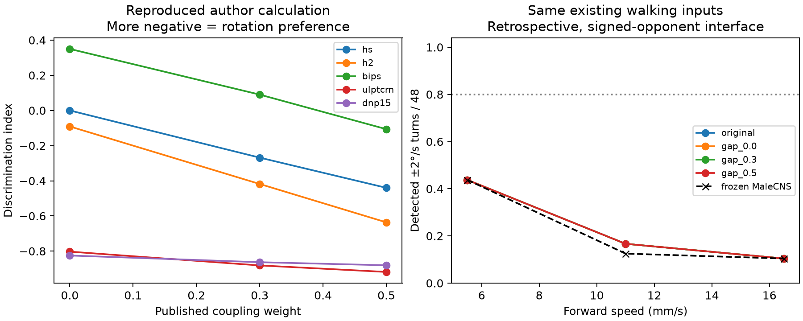

# Published HS–H2 coupling reproduced; small-turn walking transfer remains negative

2026-10-26. Completed bounded study; original MaleCNS and previous results preserved.

The published calculation reproduces successfully. Adding its fixed coupling
improves rotation preference for idealized stimulus patterns, but **does not improve
the number of ±2°/s walking turns detected** in our matched-input comparison.
No tested interface meets the existing small-turn criteria at all three speeds.
This closes this specific linear, globally pooled candidate without changing its
parameters to chase the desired outcome. It does not rule out biological electrical
coupling, spatially structured integration, or other physiological mechanisms.

## What was reproduced

Primary sources are [Pokusaeva et al. (2024)](https://www.nature.com/articles/s41467-024-53173-w),
Methods “HS-H2 network simulation” / Supplementary Fig. 15, and the
[authors' notebook](https://github.com/joesch-lab/Bilateral-course-control/blob/114dd16720501570ba0e6bfe27b04d6a39cba46b/flyagentmodel.ipynb).
The paper links electrical coupling with bilateral visual integration and reports
that its modeled coupling increases rotational selectivity. We executed that
calculation using the archived author code, not an inferred conductance model.
The archived repository and figure workbooks were already available locally.

Executed the notebook's paper calculation cells 49–50 with their required definition
cells, all eight abstract stimuli and all six author conditions, with two fixed
random seeds. An independent 11-state matrix implementation matches all **96
unrounded solutions** within **8.53×10⁻¹³** model units. Every fsolve termination
reports success. The independently recomputed DI agrees with the authors' rounded
calculation wherever defined. Four of the 60 DI entries are undefined because
silenced bIPS/uLPTCrn have zero response range; they remain null, not invented zeros.

DI compares translation response range with rotation response range; a more
negative value indicates stronger rotation preference. The clean comparison keeps
all chemical terms identical and changes both effective coupling weights from
0 to 0.5:

| Cell class | Coupling 0 | Coupling 0.5 | Change |
|---|---:|---:|---:|
| HS | 0.0000 | −0.4400 | −0.4400 |
| H2 | −0.0909 | −0.6364 | −0.5455 |
| bIPS | 0.3500 | −0.1064 | −0.4564 |
| uLPTCrn | −0.8029 | −0.9184 | −0.1155 |
| DNp15 | −0.8250 | −0.8805 | −0.0555 |

The frozen reproduction gate passes. These are author-code reproduction and
agreement with the published direction of effect. The notebook contains no saved
outputs; the S15 source workbook supplies chemical connectivity, not independent
numerical DI targets. Exact numerical agreement with published figure values or
physiological recordings has **not** been established.

The notebook's `original` condition also changes contralateral visual weights,
so it is separate from the clean coupling comparison. Its `H2_0.0` condition also
changes HS→uLPTCrn from 0.5 to 0.7; we reproduced this literally and do not call
it a selective H2 lesion. The weights are dimensionless effective terms, not
measured gap conductances or MaleCNS specimen-specific electrical edges. The
paper calculation uses a linear steady-state system; optional nonlinear notebook
explorations were not substituted after seeing the result.

[All solutions](../results/pokusaeva_gap_reproduction_v1_r2/reproduction/solutions.json),
[DI values](../results/pokusaeva_gap_reproduction_v1_r2/reproduction/DI.csv),
[reproduction receipt](../results/pokusaeva_gap_reproduction_v1_r2/reproduction/completion.json),
[source provenance](../results/pokusaeva_gap_reproduction_v1_r2/sources/provenance.json).

## Matched walking comparison

Only after reproduction passed, a second manifest froze the conditional transfer.
Reused **704 existing episodes from 44 environments**: stationary controls and
walking at 5.5, 11 and 16.5 mm/s, each with yaw 0, ±2 and ±5°/s. No images,
frontend parameters, original graph or previous outputs were changed.

Connected the unchanged functional T4/T5 surrogate to the small published circuit
through two explicitly uncalibrated interfaces. For each eye, equal-weight subtype
means give F=(T4a+T5a)/2 and B=(T4b+T5b)/2. The primary interface supplies signed
(F−B, B−F), matching the author's signed abstract vectors. The secondary supplies
rectified (F,B). Neither is a reconstructed physiological retinal detector, a
measurement model, or the authors' image frontend. Spatial averaging remains a
modeling assumption. The original MaleCNS network supplies context, not input to
this reference circuit; this avoids adding coupling twice to existing HS/H2 rates.

Tested all four fixed author variants (`original`, gap 0/0.3/0.5) and both interfaces;
saved bilateral responses for all five cell classes. Fit 120 standard ridge yaw
decoders using four training rooms, set cutoffs from 16 separate calibration rooms,
and serialized them **before loading new test features** from the remaining 24 rooms.
Test-room outcomes from earlier models were already known: this is a retrospective
comparison, not fresh prospective generalization. Decoders are separately conditioned
on walking speed, as in the prior benchmark. No neural weight was fitted.

The existing criteria remain ≥80% detection, ≥80% raw-direction accuracy and ≤10%
observed false alarms, sustained at the larger tested magnitude. With 48 signed
turns and 24 straight episodes per speed, this means ≥39 detections, ≥39 correct
raw directions and ≤2 false alarms. Undetected turns remain in the raw-sign denominator.

Primary DNp15 results at ±2°/s:

| Speed (mm/s) | Gap 0 detected | Gap 0.5 detected | Gap 0.5 correct raw direction | Gap 0.5 false alarms | Acceptable? |
|---|---:|---:|---:|---:|---|
| 5.5 | 21/48 | 21/48 | 42/48 | 2/24 | No |
| 11 | 8/48 | 8/48 | 34/48 | 1/24 | No |
| 16.5 | 5/48 | 5/48 | 30/48 | 1/24 | No |

Gap 0.3 also detects 21/48, 8/48 and 5/48. The rectified interface detects
19/48, 8/48 and 5/48 for each coupling setting. The original frozen MaleCNS context
detects 21/48, 6/48 and 5/48 on these same episodes; differences between distinct
circuit models cannot be attributed to electrical coupling alone.

At ±5°/s, the primary gap-0.5 circuit detects 46/48, 22/48 and 18/48.
Its finite-grid threshold is therefore 5°/s at slow speed and unresolved on the
tested 2/5°/s grid at medium/fast speed. This does not establish thresholds beyond
5°/s. No tested interface/variant satisfies the ±2°/s capability across speeds.

Paired room bootstrap results show zero change in ±2°/s detection for every tested
coupling comparison. In the primary slow-speed comparison, one straight episode
changes from a false alarm to no alarm (3/24→2/24); its 95% paired-bootstrap interval
for false-alarm change is [−12.5, 0] percentage points. Report that change, but do
not treat it as a robust fix. Secondary-interface raw-sign accuracy improves by
1/48 at medium/fast speed without any detection gain. All these comparisons share
the same 24 rooms and are not independent experiments.

[Every feature, decoder and prediction](../results/pokusaeva_gap_reproduction_v1_r2/transfer),
[complete curves](../results/pokusaeva_gap_reproduction_v1_r2/transfer/curves.csv),
[paired effects](../results/pokusaeva_gap_reproduction_v1_r2/transfer/paired_effects.json),
[thresholds](../results/pokusaeva_gap_reproduction_v1_r2/transfer/thresholds.csv).



Here `original` labels the author's original circuit, while `frozen MaleCNS`
labels our existing connectome model. All four published-variant detection curves
overlap in the primary walking comparison. The dotted line is the detection
criterion; sign and false-alarm criteria also apply.


## Why the abstract improvement does not fix this walking task

At the signed-opponent interface, there are only two independent eye signals.
The DNp15 bilateral mapping has rank two for all four variants. Increasing coupling
from 0 to 0.5 multiplies the **entire left–right DNp15 difference by exactly two**,
for any input at this interface. It therefore doubles both the small-yaw response
and scene-induced straight-walking asymmetry. This is an exact statement about
this fixed model/interface, not a claim that all biological gap junctions merely
amplify signals.

Consequently, straight-scene SD / median absolute ±2°/s odd response remains
**0.457, 0.908 and 1.383**, unchanged by coupling at all speeds. This descriptive
ratio is not physiological noise, d′ or a detection threshold. Mathematical
linearity preserves this balance even though ideal translation/rotation DI improves.
An invertible mapping of two inputs adds no information; standardized ridge fits
can still differ because regularization depends on feature coordinates. That
accounts for the possibility of slightly different decisions without a new signal.

The additional algebraic interpretation was checked after outcomes and is labeled
retrospective. It is not a newly imposed acceptance rule or proof of biological
causality. The result supports stopping repeated coupling-gain adjustments in this
specific globally pooled linear configuration.

[Input mapping and ranks](../results/pokusaeva_gap_reproduction_v1_r2/transfer/input_rank.json),
[all offset ratios](../results/pokusaeva_gap_reproduction_v1_r2/transfer/offsets.csv),
[independent algebra/fit review](../results/pokusaeva_gap_reproduction_v1_r2/additional_arithmetic_review.json).

## Numerical evidence, failures and boundaries

All 96 author roots, 120 independent decoder fits/cutoffs and 14,400 test scores
and decision counts pass numerical review. Four raw-source checks reproduce the
cached source means exactly, with body-ID ordering checked against the original
arrays. Averaging time samples before/after the linear circuit differs by at most
2.16×10⁻⁸ including the scaled angular-output component, from float32 averaging
order. This does not replace the original frontend's retinal/temporal convergence
checks; no new dynamics or new retinal rendering is claimed. Fresh-process full
replay reproduces all 96 roots, all 704 walking conditions, every fit and prediction,
and every retained bootstrap array exactly. Original frontend and graph hashes pass.

The first attempt failed in our wrapper's independent DI calculation for a zero
response range. The author calculation returns NaN; our wrapper raised division
by zero. Preserved the failed attempt and frozen code; corrected output handling
in a fresh namespace with explicit undefined/null values and unchanged scientific
criteria/parameters. No failed output was overwritten. The web tool also failed
to fetch the article-linked supplement PDF; the already archived notebook was
sufficient for this bounded code reproduction. The raw archive manifest has a
noncanonical article title and a shortened commit string; the new provenance uses
the verified full Git commit and canonical primary-paper link without editing it.

Limitations: global spatial pooling, uncalibrated frontend-to-circuit units,
deterministic images, no measured neural noise, signed states rather than calibrated
spike rates or membrane voltages, no held-out physiological recordings, and reused
test rooms. The model does not reproduce all shakB interventions or the paper's
behavioral experiments. Electrical interactions beyond the published effective
terms remain unresolved. No new anatomical connections, conductances or physiological
parameters were inferred. Observed false-alarm fractions from 24 rooms are not
population guarantees. No closed-loop controller or physical deployment was added.

[Numerical review](../results/pokusaeva_gap_reproduction_v1_r2/numerical_review.json),
[fresh full replay](../results/pokusaeva_gap_reproduction_v1_r2/fresh_replay_review.json),
[preserved first failure](../results/pokusaeva_gap_reproduction_v1/FAILED_ATTEMPT.json),
[protocol](POKUSAEVA_GAP_REPRODUCTION_PROTOCOL_V1.md),
[study completion](../results/pokusaeva_gap_reproduction_v1_r2/completion_v1/completion.json),
[artifact index](../results/pokusaeva_gap_reproduction_v1_r2/completion_v1/artifact_index.json),
[post-exit integrity](../results/pokusaeva_gap_reproduction_postseal_v1.json).

## Reproduction

Use the existing Linux CPU environment recorded in
[environment.json](../results/pokusaeva_gap_reproduction_v1_r2/environment.json).
Dependencies include NumPy, SciPy and pandas; matplotlib is needed for figures.
The source snapshot and existing V2/source-attribution inputs must be present.
All writers require a fresh destination:

```bash
export PYTHONPATH=src:scripts
export OPENBLAS_NUM_THREADS=1
export OMP_NUM_THREADS=1
PYTHON=<HOME>/Lab/mech_male_fly_cns/.venv/bin/python
DEST=results/pokusaeva_gap_independent_replay_v1
for stage in prepare reproduce freeze_transfer transfer review plot; do
  "$PYTHON" scripts/pokusaeva_gap_reproduction_v1.py "$stage" --destination "$DEST"
done
```

Proceed beyond `reproduce` only if its completion receipt is PASS. The executed
fresh replay is also available in the study directory. The archival `seal` and
`postseal` stages of `finish_pokusaeva_gap_v1.py` are single-use; do not rerun them
into completed evidence.

## What we did, what we want, and why — undergraduate explanation

We want to understand how a walking fly notices a small accidental turn while
the scenery is already moving past its eyes. We reproduced another lab's small
circuit and tested whether communication between the two eyes helps. It works
for their simple motion patterns, but on our walking scenes it strengthens both
the useful turn signal and the misleading scene differences. Small turns therefore
remain hard to detect. This is useful progress: we now have a working published
reference and a specific reason this addition alone is insufficient. A next neural
study needs evidence for separating those two sources of visual motion—such as
spatially resolved bilateral responses—rather than simply increasing their strength.
