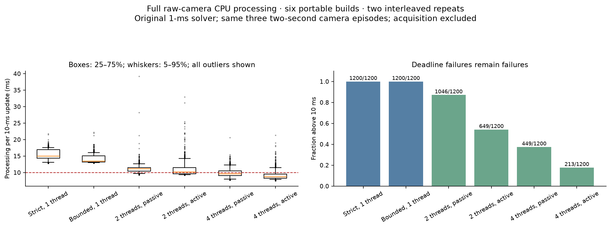

# Portable Linux CPU camera runtime — V3

Completed software component 2026-10-21, America/Belem. The broad validation/hardware goal remains active; physical-camera, physiological and real-time validation remain unestablished.

**Delivered:** a self-contained 32,672,054-byte source/model archive, defaulting to portable Linux CPU execution and the original strict 1-ms solver. It includes nonlinear synthetic camera calibration, three complete two-second raw-camera fixtures, independent Python references and a standalone self-check. All numerical integration checks pass. Default CPU processing misses every 10-ms paired-update deadline. Optional four-thread processing improves typical throughput but still misses deadlines. Neither scientific detection failures nor timing failures are relabeled success.

[Downloadable local archive](../results/validation_hardware_v1/deployment/original_runtime_cpu_v3.zip), [exported README](../results/validation_hardware_v1/deployment/original_runtime_cpu_v3/README.md), [prospective engineering protocol](CPU_CAMERA_DEPLOYMENT_PROTOCOL_V3.md), [camera runtime source](../src/male_optic_frontend/camera_runtime_v3.py).

## Complete camera-to-network execution

The fixed cases use historical training room s01 at 16.5 mm/s with yaw 0, +20 and −20°/s. Each contains 401 binocular raw frame pairs at 5-ms spacing and 201 neural samples over two seconds. Motion occurs during 0.5–1.5 s. These are software regression cases, not independent biological experiments or a newly trained classifier.

Each synthetic camera has a 320×320 equidistant lens, a circular 95° half-field and a declared optical orientation. The original 0.3-mm eye baseline is retained. All 29,929 required rays per eye and every interpolation corner lie within the aperture; maximum required ray angle is 89.7212°. Round-trip projection error is below 7.78×10⁻¹⁶ and ray-norm error below 3.34×10⁻¹⁶. The maps are nonidentity and preserve the opposite horizontal eye-chart conventions. Opaque lens housing is outside required coverage. The manifest states **SYNTHETIC_TEST_ONLY**; this is not a measured camera calibration. [Projection checks](../results/validation_hardware_v1/cpu_camera_v3/projection_checks.json), [calibration](../results/validation_hardware_v1/cpu_camera_v3/calibration/calibration.json).

Raw frames integrate a declared 1-ms exposure using two-point quadrature, encode radiance with a square-root response, and store integer common-clock exposure-midpoint timestamps. The adapter applies the inverse photometric lookup before interpolation. Independent four-corner extended-precision projection exactly matches the adapter across all three complete sequences. Eighteen sparse raw-ray checks against the original Python renderer also agree exactly. The descriptive two-versus-four-node exposure comparison has maximum luminance discrepancy 1.79×10⁻⁴ over the checked rays; it does not establish continuous-exposure convergence or biological optics. [Fixture manifest](../results/validation_hardware_v1/cpu_camera_v3/fixtures_complete.json), [raw-ray checks](../results/validation_hardware_v1/cpu_camera_v3/raw_ray_checks.json), [exposure diagnostic](../results/validation_hardware_v1/cpu_camera_v3/exposure_quadrature_diagnostics.json).


The archive was extracted into a separate `/tmp` directory and run with project `PYTHONPATH` cleared, using only exported source/model/calibration/fixtures plus NumPy, SciPy and the installed C++17 compiler. It needs no CUDA dependency. The self-check verifies all 37 package-index entries, builds portable libraries without native CPU flags, and replays all three full episodes. It checks rates, full final states, complete preserved episode decisions, seven rejected-input cases and bit-identical reset/replay. Bad coverage was tested with a valid updated array hash, so rejection exercises missing coverage rather than merely file corruption. [Standalone self-check](../results/validation_hardware_v1/cpu_camera_v3/standalone_strict_v1/selfcheck.json), [build provenance](../results/validation_hardware_v1/cpu_camera_v3/standalone_strict_v1/build.json).

Across the initial strict replay, optional activation replay and 36 interleaved CPU comparisons, 42 complete episodes and 8,400 neural updates were independently reviewed. Maximum rate discrepancy from the Python reference is 1.74×10⁻¹⁸; full final-state discrepancy 8.14×10⁻²⁰; episode-score arithmetic discrepancy 1.78×10⁻¹⁴. Every recorded episode decision agrees with its reference. Input time discrepancies are at most 2.23×10⁻¹⁶ s. The original graph, frontend parameters, time constants and decoder coefficients/cutoffs remain unchanged. [Independent review](../results/validation_hardware_v1/cpu_camera_v3/independent_review_v1/review.json).

Numerical agreement means reproducing the model's actual outputs. DNp15 gives decisions 0/+1/−1 on these three cases, but H2 gives wrong-direction detections on both ±20°/s cases, while HS and bIPS flag the straight case. Those failures are preserved in the reference manifest. Three selected training-room fixtures do not establish discrimination accuracy, and no decoder is tuned to repair them. The separate [generalization/convergence report](VALIDATION_GENERALIZATION_CONVERGENCE_REPORT_V1.md) identifies the larger scientific failures.

## Measured performance and optimization limits

Timing includes raw camera projection, the compiled frontend and the full neural graph. It excludes acquisition, transport, rendering and file loading. Replay is unpaced. Initial strict replay processes 600 paired updates with median 16.928 ms, p95 18.042 ms and all 600 above 10 ms. Startup initialization takes 65.2–73.4 ms per case. Observed process peak RSS is at most 182,943,744 bytes (174.5 MiB) in that run, including file replay arrays; this is not a device-driver memory measurement or proof against all leaks.

An explicitly optional bounded activation build retains the original 1-ms clock and passes the same numerical cases; its initial median is 13.355 ms, still with 600/600 misses. No default is changed. The next predeclared matrix interleaves six portable configurations in two randomized repeats, each replaying all three complete episodes. Each configuration has 1,200 paired updates. Separate child processes establish active/passive OpenMP waiting before loading the libraries; no affinity, driver or system settings are changed. Scientific simulation workers have finished, and actual host load is recorded. [Initial optional build](../results/validation_hardware_v1/cpu_camera_v3/standalone_activation_v1/benchmark.json), [matrix before execution](../results/validation_hardware_v1/cpu_camera_parallel_v1/before_execution.json).

| Portable configuration | Median paired time | p95 | Misses / 1,200 |
|---|---:|---:|---:|
| Strict, one thread | 15.005 ms | 17.614 ms | 1,200 |
| Bounded activation, one thread | 13.434 ms | 16.088 ms | 1,200 |
| Two threads, passive waiting | 11.126 ms | 12.680 ms | 1,046 |
| Two threads, active waiting | 10.111 ms | 14.253 ms | 649 |
| Four threads, passive waiting | 9.613 ms | 12.256 ms | 449 |
| Four threads, active waiting | 8.757 ms | 11.505 ms | 213 |

The best observed median configuration has 109.12 updates/s unpaced processing throughput, but **213/1,200 (17.75%)** individual updates miss 10 ms; its worst is 21.355 ms. This is a measured implementation improvement, not a real-time guarantee or a recommendation for an untested board. The exported V3 archive contains the strict/default and explicit single-thread activation option; the row-parallel candidates are separately versioned project sources and benchmark artifacts, not silently substituted into that archive. [All 36 numerical/timing records](../results/validation_hardware_v1/cpu_camera_parallel_v1/benchmark.json), [parallel kernel](../src/male_optic_frontend/deployment_neural_v3.cpp).



A **post-score engineering diagnostic** separates alternate frames that update only the frontend from frames that also run the neural solver. With four active-wait threads, their medians are 2.946 and 5.820 ms, respectively. There are 10/1,200 and 1,198/1,200 frame-budget misses at 5 ms. The 10-ms aggregate alone therefore understates the burst at neural frames. This motivates separately versioned projection-efficiency and work-scheduling improvements; no frame is discarded, temporal resolution changed or unmeasured prediction inserted here. [All frame-phase diagnostics](../results/validation_hardware_v1/cpu_camera_v3/report_v1/postscore_frame_phase_diagnostic.csv).

## Reproduction and deployment boundary

From a fresh extracted package directory, after installing its declared dependencies:

```sh
python selfcheck_cpu_camera_v3.py --work selfcheck_run
```

Use a new work directory for each repeat. The exported README also provides standalone build and raw-camera replay commands. Outputs preserve raw per-frame/paired timings, identified neural rates, full final states, episode results and calibration hashes. Live producers can use `CameraPerceptionPipeline` one binocular pair at a time. A physical camera requires its own measured ray maps, photometric response, full retinal coverage, fixed acquisition modes and synchronized clocks. The package supplies no acquisition driver or motor interface.

The optional episode decoder requires independently supplied model-scale forward speed and the full 70-sample historical window; it emits at 1.4 s. Numerical cutoff annotations use an explicit assumed 10⁻¹⁰ per-cell rate error bound, transformed through the frozen linear readout. They do not alter decisions or describe biological noise/confidence. Raw resampling, quantization and exposure change the visual input relative to the original panoramic simulations, so matching the independent camera-derived reference does not assert equivalence to those earlier visual scenes.

This deliverable establishes an executable CPU perception package and scoped numerical agreement on synthetic cameras. Continuous scheduled acquisition, sustained CPU operation, exact physiological stimulus matching, physical calibration and robot navigation remain separate validation work. All predecessor evidence and earlier V1/V2 archives remain preserved. The completed scientific component has a [corrected V2 seal](../results/validation_hardware_v1/scientific_completion_v2/artifact_index.json); the preserved [V1 bookkeeping defect](ARTIFACT_SEAL_CORRECTION_V2.md) involved only its own final sealer log, with scientific data unchanged.

## Undergraduate explanation: what we did, what we want and why

We want a fly-inspired vision model that can eventually run on a real machine and help detect unwanted turns. We packaged the existing model so a Linux CPU can process camera-like images, and checked the complete calculation against an independent Python reference. That software check passed, including the full turn-detection window and faulty-input handling. The remaining problem is speed and reliability: the default CPU version falls behind the intended camera stream, while faster options still have late updates. We also kept the model's incorrect neural predictions rather than changing it to look successful. This gives us a reproducible starting point for improving execution speed and testing real cameras, while keeping biological claims tied to actual experiments.
