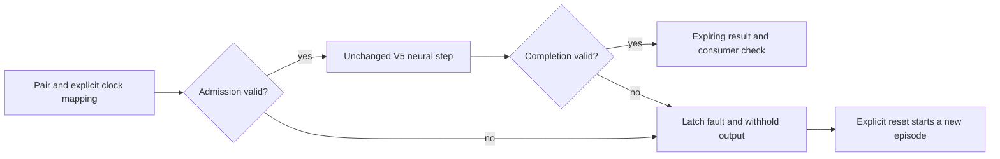

# Camera clock bounds and expiring perception results — V6

Completed 2026-10-22, America/Belem. Presentation revision R2 moves the legend outside data bars and updates figure links; original reports/figures are preserved, with identical numerical tables. Numerical/API component; broad biological and hardware-readiness goal remains active.

**Outcome:** the portable CPU implementation now has an explicit camera-to-host clock contract, pre/post-processing freshness checks, reset-aware result expiry and one-time episode-decision emissions. All tested original neural values are preserved. A strict fault latch would nevertheless withhold most frame opportunities in the saved V5 run. This improves fault visibility and interface correctness, not execution reliability or physiological agreement.

## Clock and output contract

V6 wraps the unchanged V5 compiled camera projection, causal held-input solver and frozen model. It preserves the graph, gains, frontend, original 1-ms integration, 5-ms camera cadence, 10-ms published neural cadence and 70-sample episode readout. No unknown connection or conductance is added. The default remains strict single-thread computation; optional four-thread bounded activation is explicit. [Prospective protocol](CAMERA_CLOCK_FRESHNESS_PROTOCOL_V6.md), [guard](../src/male_optic_frontend/camera_clock_guard_v1.py), [factory](../src/male_optic_frontend/camera_runtime_v6.py).

The caller supplies a common camera clock mapping with integer camera/host anchors, positive rational rate, uncertainty bound, validity interval, provenance and measured/synthetic status. Camera timestamps must denote exposure midpoints. For camera tick C, anchors C0/H0, rate p/q and uncertainty u, the lower/upper host bounds are H0+floor((C−C0)p/q)−u and H0+ceil((C−C0)p/q)+u. Integer arithmetic preserves absolute timestamps above 2^53, negative anchor offsets and conservative rounding.

The producer records availability A on the same monotonic host clock used by the guard, after both complete images are available. Both mapped exposure midpoints must be definitely before A. Admission and completion observations must satisfy D=min(A+5,000,000 ns, earliest possible binocular exposure midpoint+5,000,000 ns). Equality passes. The image-age criterion includes transport/queuing and clock uncertainty; both 5-ms bounds are frozen engineering choices of one frontend period, not fitted physiological parameters or replacements for V5 criteria. The software checks supplied synchronization assertions; it does not establish their physical validity.



Any step fault invalidates previous wrapper results and latches until explicit reset. The failed internal state remains available for diagnosis, rather than silently resetting or inventing missing history. Successful results contain copied read-only rates, source bounds, expiry, owner/reset generation and sequence. A consumer check rejects expired, foreign and pre-reset objects. It certifies its observation instant only: OS preemption after a check can still delay consumption. Step/reset/check operations are serialized; status contains bounded counters and the last fault, without a cached last-valid prediction.

The original runtime retains its episode classification after emission at 1.4 s. The wrapper exposes it once through `new_episode_detection`, then returns an empty tuple on later frames. It does not present an old episode decision as a new instantaneous yaw estimate. With independently supplied walking speed omitted, the optional classifier remains disabled. New motor control, camera drivers and automatic clock calibration are absent.

## Executed validation and portability limits

All **167 behavioral tests** pass, including independent exact-fraction clock checks, uncertain/oldest-eye age, equality boundaries, future/reordered availability, host rollback, clock validity expiry, finite-output handling, explicit reset, consumer generations, interruptions and step/reset serialization. Six project preflight and six isolated package cases preserve every published wide-neuron rate, complete final FP64 state and original episode decision. Each case also checks eight faults: stale input, late initial/intermediate/source/episode output, mapping expiry, future availability and partial neural failure. The independent review verifies all **96 retained fault states** against sealed V5 full-population states, along with reset prefixes and one-time emissions. [Passing tests](../results/validation_hardware_v1/cpu_camera_clock_v6/unit_tests_r3.log), [preflight](../results/validation_hardware_v1/cpu_camera_clock_v6/preflight.json), [authoritative independent review](../results/validation_hardware_v1/cpu_camera_clock_v6/independent_review_v2/review.json).

Maximum rate/final-state errors against original goldens are 1.73e-18/8.13e-20; independent original episode arithmetic agrees within 1.78e-14. All retained fault and reset states are bit identical to the matched sealed V5 states. The original 1e-10 criterion is unchanged. Example clock-file loading and four invalid configurations are checked independently. These are numerical and API checks, not physiological validation.

The full camera logic trace declares a 0.5-ms delivery offset, 100-ns clock uncertainty and 2-ms computation observations. These times are synthetic, even when the actual strict computation takes longer. They exercise the guard logic and make **no speed claim**. Hardware timing is still represented by the failed V5 scheduled benchmark. Both strict/optional builds were compiled and executed from a separate extracted /tmp folder with project imports cleared. Host: 12th Gen Intel(R) Core(TM) i5-12450H, 12 logical CPUs; Python 3.14.8, NumPy 2.4.6, SciPy 1.18.1; platform `Linux-7.2.11-200.fc44.x86_64-x86_64-with-glibc2.43`. This is one tested host, not cross-platform validation. [Environment and compiler](../results/validation_hardware_v1/cpu_camera_clock_v6/host_environment.json), [strict standalone](../results/validation_hardware_v1/cpu_camera_clock_v6/standalone_strict_v1/selfcheck.json), [parallel standalone](../results/validation_hardware_v1/cpu_camera_clock_v6/standalone_parallel4_v1/selfcheck.json).

## Retrospective availability analysis: negative findings retained

Evaluate every frame of the complete V5 mixed-mode schedule in two fixed scenarios: software availability equals exposure midpoint with zero uncertainty; or a hypothetical midpoint 0.5 ms earlier, with 100-ns uncertainty. The second assumption matches the logic trace but is not measured capture latency. Original timings were already known, so this is explicitly retrospective policy analysis. No frame, duration or original gate changes. Wrapper overhead was not measured and is not included. [Scenario declaration](CAMERA_CLOCK_RETROSPECTIVE_SCENARIOS_V6.md), [frozen inputs and all flags](../results/validation_hardware_v1/cpu_camera_clock_v6/retrospective_policy_v1/analysis.json).

| Clock scenario | Mode | Admission+completion faults | All-frame faults | Episodes needing reset | Accepted prefix | Withheld including fault |
|---|---|---:|---:|---:|---:|---:|
| software_reference | batched | 1,155+7,397 | 8,552/60,150 | 150/150 | 2,190/60,150 | 57,960/60,150 |
| software_reference | split | 900+1,502 | 2,402/60,150 | 143/150 | 17,357/60,150 | 42,793/60,150 |
| synthetic_capture_offset | batched | 1,211+15,071 | 16,282/60,150 | 150/150 | 796/60,150 | 59,354/60,150 |
| synthetic_capture_offset | split | 942+3,796 | 4,738/60,150 | 148/150 | 6,489/60,150 | 53,661/60,150 |

All-frame fault counts ask what would happen to each preserved frame in isolation. The latched calculation instead publishes only the prefix before the first fault, withholding that frame and the rest until an explicit episode reset. In the software-reference split case, only 17,357/60,150 frame opportunities remain in accepted prefixes, even though the original all-frame miss rate is 4.0%. Under the hypothetical capture offset, only 6,489/60,150 remain. This availability loss prevents a claim of continuous hardware readiness. Automatically restarting after each fault would discard model history and is not used to hide this result. Repeated fixed fixtures are not independent visual environments or biological samples.

Independent scalar arithmetic reconstructs all 240,600 scenario/frame classifications and per-episode first faults. The software reference reproduces the V5 8,552/2,402 frame misses exactly. V5 remains a failed deadline gate; withholding results does not convert it to a pass. [Quantitative tables](../results/validation_hardware_v1/cpu_camera_clock_v6/report_v2), [V5 report](PORTABLE_CPU_WORK_SPLIT_REPORT_V5.md).


## Reproduction, failures and interpretation

The [V6 CPU archive](../results/validation_hardware_v1/deployment/original_runtime_cpu_v6.zip) contains 57 indexed files, 32,857,607 bytes; SHA-256 `de4c2b09cef3a6e53fce306dfd02ac92c3d5a1696a2c4054829125611b19e743`. All 50 V5 baseline entries are preserved, with the old README/protocol given explicit baseline names. Models and numerical sources remain byte identical. The new README contains the one-pair producer API and explicit fault/reset contract. Optical and clock examples remain SYNTHETIC_TEST_ONLY and are never automatically treated as measured calibration. [Exported README](../results/validation_hardware_v1/deployment/original_runtime_cpu_v6/README.md).

From a fresh extraction with Python, NumPy, SciPy and C++17 installed:

```sh
python selfcheck_cpu_camera_v6.py --work check_strict
OMP_WAIT_POLICY=ACTIVE OMP_DYNAMIC=FALSE python selfcheck_cpu_camera_v6.py --threads 4 --approximate-activation --work check_parallel
```

Use fresh output directories. Optional unit tests also need pytest. A real producer must supply measured optical coverage/photometry, synchronized stereo acquisition and a justified camera/host clock mapping. Results have an expiry, not a guarantee about later OS scheduling or actuator timing.

Preserved failures include the initial module-placement collection error and a test that injected NaN on a frame publishing no rate; the corrected test targets a published source frame. Production guard behavior and criteria were unchanged. The first independent reviewer was deliberately interrupted because it repeatedly decompressed arrays for scalar checks. Its source, interrupted log and record remain preserved. V2 loads arrays once and executes the same assertions; no scientific condition or model output changed. [Collection failure](../results/validation_hardware_v1/cpu_camera_clock_v6/preflight_collection_failure_v1), [test correction](../results/validation_hardware_v1/cpu_camera_clock_v6/preflight_behavior_failure_v2), [interrupted review](../results/validation_hardware_v1/cpu_camera_clock_v6/independent_review_v1/interruption.json).

A read-only exploratory audit finds 192,967 incoming chemical entries in the frozen 13,579 T4/T5 source rows and 10,894 in the 14 wide-neuron rows. An uncoupled analytic source update would therefore change this numerical model and is not a supported speed shortcut. CPU topology was recorded without changing affinity/priority. Further performance work must preserve these interactions and test scheduling changes separately. [Audit](../results/validation_hardware_v1/cpu_camera_clock_v6/cpu_constraints_audit_v1.json).

Original visual failures, including wrong-direction H2 fixture decisions and HS/bIPS straight-case false alarms, remain unchanged. This work does not establish robust small-yaw detection, biological causality or physiological validity. Image-to-recording matching, missing biological constraints and actual physical camera trials remain unresolved. [Scientific limitations](VALIDATION_GENERALIZATION_CONVERGENCE_REPORT_V1.md), [physiological limitations](CORRECTED_PHYSIOLOGICAL_DIAGNOSTICS_REPORT_V2.md). The next engineering bottleneck is reliable continuous execution under a real acquisition stream; a strict latch is a diagnostic boundary rather than a substitute for that work. Closed-loop locomotion remains deferred.

## Undergraduate explanation: what we did, what we want and why

We want a fly-inspired vision system that can notice unwanted turns and eventually work on real hardware. We added rules that say how camera time relates to computer time, how old an image may be, and when a result expires. The original neural calculations stayed the same. The system now reports faults and avoids presenting an old episode decision as a new one. But our saved timing data show that stopping after the first late image would interrupt most episodes. This tells us why detecting a timing problem and running reliably are different achievements. We have a clearer, testable CPU interface; we still need more reliable execution, measured cameras and biological comparisons before using it to control a robot.
