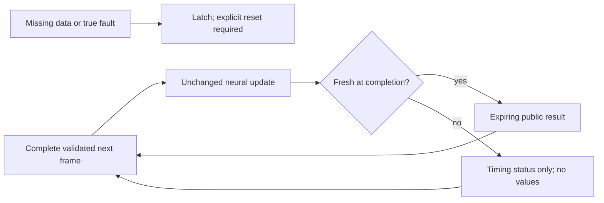

# Preserve neural history through complete delayed camera frames — V8

Completed 2026-10-22, America/Belem. Numerical/API component; broad hardware and physiological objective remains active.

**Outcome:** a separately versioned wrapper processes every complete, ordered and validated image even when it is old, withholds expired output values, and resumes publication after catch-up. All tested original computed neural values are preserved. Missing/invalid data and computation faults still require explicit reset. This improves history retention and potential output availability; **the original zero-miss timing gates still fail**. No new wall-clock benchmark, physical camera validation or physiological agreement is claimed.

## What changed and what stayed fixed

The original V6 wrapper latches after a late frame. V8 separates a timing overrun from an invalid source history. Complete, calibrated, correctly ordered images remain usable for advancing the original recurrent model, even when their outputs are too old to publish. The wrapper keeps the exact source timestamps and all input history. It never reconstructs a missing frame, interpolates future input, retimes the neural clock, drops an image or automatically resets. A future valid result can be published after processing catches up. The old strict wrapper remains available unchanged. [Prospective protocol](CONTINUING_CAMERA_PROTOCOL_V8.md), [new wrapper](../src/male_optic_frontend/continuing_camera_v1.py), [factory](../src/male_optic_frontend/camera_runtime_v8.py).

| Condition | Strict V6 policy | Continuing V8 policy |
|---|---|---|
| Complete ordered input; only its timing bound is exceeded | Latch until reset | Process input; withhold expired values; retain history |
| Later complete result is fresh | Requires a new episode after reset | Publish it using the preserved state |
| Missing/repeated/reordered frame, invalid mode/dtype, expired mapping, future clock data or clock rollback | Latch until reset | Latch until reset |
| Neural failure or malformed/nonfinite output | Latch until reset | Latch until reset |
| Original episode event is late | Event unavailable after fault | Expire it permanently; never replay the cached classification |

The graph, chemical interactions, frontend, pixel projection, gains/time constants, original 1-ms solver, 5-ms camera cadence, 10-ms source-rate cadence and original decoder remain unchanged. Strict one-thread activation is still the build default; the existing four-thread acceleration/placement is optional. No connection, conductance or biological parameter is introduced or fitted.

The same explicit integer/rational camera-to-host mapping and fixed engineering bounds apply: 5,000,000 ns after availability and 5,000,000 ns after the earliest possible binocular exposure midpoint, including uncertainty. Admission/completion observations must meet both bounds for publication; equality passes. A withheld outcome carries status/timestamps but no neural value or decision. A fresh intermediate frame can instead contain a valid result with rate=None, preserving the original 100-Hz neural publication cadence.

Output generation invalidates older consumer objects after withholding. A separate state_episode changes only on explicit reset, so timing delays do not silently restart the recurrent circuit. Operations are serialized and status is bounded. The consumer check certifies its observation instant only; later OS preemption may still delay use. Producer acquisition must remain complete and ordered; no camera driver, acquisition queue or overflow repair is supplied.

## Episode-event handling

The historical classifier averages 70 source samples at 0.70–1.39 s and first emits at 1.4 s. These are episode summaries, not a new continuous steering estimate. V8 observes the first event even when that frame is withheld, counts it as expired and never reattaches the retained classification to a later fresh frame. Later neural rates can resume while that episode event remains unavailable. The complete computed rates and original scores remain separately saved for scientific review. Improving availability does not change classification accuracy or remove original false positives/wrong directions.



## Executed numerical and interface validation

All **28 behavioral checks** pass. Independent small-recurrence/clock oracles cover initial backlog, intermediate/source stalls, repeated and sustained lateness, deadline equality, preservation of state, fresh/withheld distinctions, output-token expiry, real-fault latching, reset episodes and permanent expiry of a late event. Sustained overload can preserve computed history yet produce no fresh outputs; continuing state is not a guarantee of useful throughput.

The full study uses the same three historical raw binocular fixtures (16.5 mm/s, yaw 0/±20°/s), strict/four-thread kernels and six frozen host traces: nominal, 12-ms initial backlog, a 35-ms intermediate stall, a 35-ms source stall, a 35-ms stall at frame 280, and repeated 12-ms stalls. Other declared work is 2 ms, with 0.5-ms availability offset and 100-ns uncertainty. Admission is max(availability, previous completion), retaining backlog instead of moving the clock backward. These clock values are synthetic and make no execution-speed claim. [Configuration](../configs/continuing_camera_v8.json), [tests](../results/validation_hardware_v1/cpu_camera_continuation_v8/unit_tests.log), [before execution](../results/validation_hardware_v1/cpu_camera_continuation_v8/before_execution.json).

All **36 project and 36 isolated complete trace replays** pass. Project checks compare each of 401 full-population states against sealed V5 references; isolated checks compare every state with a matched frozen baseline runtime. Every computed source rate, original score/decision and final FP64 state is preserved, irrespective of publication. The independent review verifies retained computed/public arrays, complete final/fault states, scalar clocks/generations/events, archive identities and every retrospective publication mask. Online full intermediate-state equality is recorded separately by the preflight checks. Maximum original rate/final-state differences are 1.73e-18/8.13e-20; independently reconstructed original score arithmetic agrees within 1.78e-14. The 1e-10 tolerance is unchanged. [Preflight](../results/validation_hardware_v1/cpu_camera_continuation_v8/preflight.json), [independent review](../results/validation_hardware_v1/cpu_camera_continuation_v8/independent_review_v1/review.json).

All **96 project/isolated true-fault checks** retain explicit reset requirements: missing/repeated frames, mapping expiry, host rollback, future availability, partial neural failure, changed acquisition mode and wrong dtype. Retained before/after full states match the appropriate sealed reference states. The late-event traces expire frame 280 exactly once; the event never reappears after catch-up. No timing-only trace resets the model.


## Retrospective output coverage in the V7 timing record

Apply the two previously fixed V6 clock assumptions to all 480 complete V7 episodes: software availability equals exposure midpoint with zero uncertainty; or a hypothetical 0.5-ms capture offset plus 100-ns uncertainty. V7 outcomes were already known, so this is retrospective coverage arithmetic. All old frame/paired misses remain failures. The new wrapper's overhead and physical acquisition are absent from those timings; the table is a counterfactual availability estimate, not measured V8 performance.

| Clock scenario | V7 placement | Strict → continuing 100-Hz rates | Strict → continuing episode events | Expired events retained as unavailable | Unchanged frame faults |
|---|---|---:|---:|---:|---:|
| software_reference | unbound | 14,285 → 45,713 /48,240 | 22 → 224 /240 | 16 | 4,616/96,240 |
| software_reference | bound | 29,583 → 47,161 /48,240 | 114 → 237 /240 | 3 | 2,080/96,240 |
| synthetic_capture_offset | unbound | 6,901 → 43,251 /48,240 | 6 → 212 /240 | 28 | 8,676/96,240 |
| synthetic_capture_offset | bound | 24,714 → 46,859 /48,240 | 79 → 236 /240 | 4 | 2,600/96,240 |

For the bound software-reference case, available neural samples rise from 61.32% to 97.76%, and episode events from 114/240 to 237/240. Three late events remain expired. The same **2,080/96,240** timing failures remain; unbound still has **4,616/96,240**. These counts do not measure detection sensitivity or biological success. The original neural values and incorrect predictions are retained in full. Repeated fixtures are not independent animals or environments. [All masks and summaries](../results/validation_hardware_v1/cpu_camera_continuation_v8/retrospective_policy_v1/analysis.json), [V7 measured timing](PORTABLE_CPU_PLACEMENT_REPORT_V7.md).

Independent scalar arithmetic reconstructs all 384,960 scenario/frame classifications, actual 100-Hz publication opportunities and original event eligibility. Strict prefixes stop after the first fault; continuing publication requires each individual result to satisfy the original age/response bounds. No late classification is shifted to a later frame.


## Portable artifact, reproduction and limitations

The [V8 CPU archive](../results/validation_hardware_v1/deployment/original_runtime_cpu_v8.zip) contains 69 indexed files and 32,921,977 bytes; SHA-256 `aa28463fe888a3ec9c0d1a0818411a1a21d2ddc6adf784ff5cd12021a09febb7`. All 62 V7 baseline entries are preserved byte for byte, with README/protocol given explicit baseline names. The old strict API remains available. Fresh isolated strict and four-thread builds execute all six traces/three fixtures each. [README and one-pair API](../results/validation_hardware_v1/deployment/original_runtime_cpu_v8/README.md), [strict check](../results/validation_hardware_v1/cpu_camera_continuation_v8/standalone_strict_v1/selfcheck.json), [parallel check](../results/validation_hardware_v1/cpu_camera_continuation_v8/standalone_parallel4_v1/selfcheck.json).

From a fresh extracted package with the declared Python/NumPy/SciPy/C++17 dependencies, plus OpenMP for optional workers:

```sh
python selfcheck_cpu_camera_v8.py --work check_strict
OMP_WAIT_POLICY=ACTIVE OMP_DYNAMIC=FALSE python selfcheck_cpu_camera_v8.py --threads 4 --approximate-activation --work check_parallel
```

Use fresh output directories. Only one Linux host is tested. The supplied optical/photometric calibration and clock examples are synthetic; mapping labels are supplier assertions, and intended physical sampling cadence still needs independent measurement. Long-running overload, bounded-camera-buffer overflow, dropped input, actual capture transport and downstream control are not solved by this wrapper. There is no hard-real-time guarantee. The next engineering check is measured execution with the new wrapper and real host-clock consumer checks, preserving every input and gate.

Original physiological constraints, missing interactions, small-yaw/generalization failures and image-to-recording limitations remain unresolved. This work adds no physiological validation and implements no closed-loop locomotion. [Scientific findings](VALIDATION_GENERALIZATION_CONVERGENCE_REPORT_V1.md), [physiological limitations](CORRECTED_PHYSIOLOGICAL_DIAGNOSTICS_REPORT_V2.md). Numerical/API correctness, measured execution and biological agreement remain distinct requirements.

## Undergraduate explanation: what we did, what we want and why

We want a fly-inspired visual system that can notice unwanted turns and eventually work on real hardware. We changed how the software handles a temporary delay: it keeps calculating from every complete image, hides results that are already too old, and starts publishing again once it catches up. The neural model and its predictions stayed the same. A missing image or a real computation fault still stops the stream. Tests show that the model keeps its history, and old timing records suggest many more results could remain usable. We still need to measure the new wrapper's speed, calibrate real cameras and compare the model with real fly recordings before using it to control a robot.
