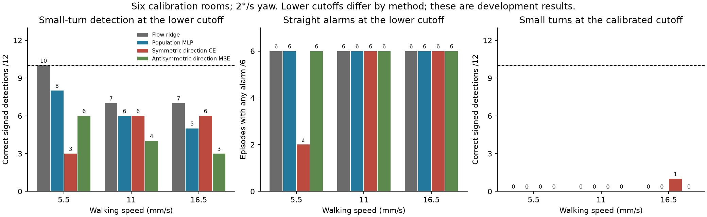

# Published neural-population yaw study: completed negative result

1 November 2026. **Neither original reader nor either direction/symmetry repair qualifies in calibration. The reserved 24-room test remains unrendered under the frozen go/no-go rule.** No new biological-validation claim is made.

[Original protocol](PUBLISHED_POPULATION_YAW_PROTOCOL_V1.md), [observation correction](PUBLISHED_POPULATION_POOLING_CORRECTION_R2.md), [post-failure repair protocol](PUBLISHED_POPULATION_DIRECTION_REPAIR_PROTOCOL_R3.md), [broader study](NEURAL_MODEL_OPTIONS_REPORT_V1.md).

## What was executed

The unchanged published neural visual network receives physically rendered binocular perspective movies. The original 34 output types are pooled into a fixed four-by-three grid per eye. Rectified neural potentials, a causal 100-ms level and its 200-ms-lagged change produce 1,632 features. A second reader observes 96 analogous decoder-field features. No direct image-motion estimator or kinematic label is an inference input.

Twelve known training rooms generate 192 episodes and six disjoint known calibration rooms generate 96. Stationary/straight episodes last 3 s, contributing all 200 callbacks in [1,3); turns last 1.3 s and contribute the 1.19-s endpoint. All 9,744 fitting samples are weighted equally by sign class and by episode within each class. The different saving horizons cannot change a causal endpoint. Fitting uses training-only normalization. No neuronal parameter is fitted.

The primary population MLP has 32 tanh hidden units, 600 fixed float64 full-batch Adam steps, learning rate .003 and weight decay .001. Its training MSE is **0.00121370**. The secondary ridge reader has mean-loss penalty .01 and MSE **0.691972**. Independent NumPy/Torch inference and augmented least squares agree within 2.23e-15 and 1.66e-13. [Fit evidence](../results/published_population_yaw_r2/fit_review.json).

After both fail calibration, the separately frozen R3 tests two fixes with the same source observations: three-class cross entropy with reflection-consistent logits, and antisymmetric regression to unit direction targets. Both keep the fixed 32-unit architecture and 600-step schedule. Actual mirrored-world images agree bitwise after swapping eyes; inference satisfies its reflection identity within 2.23e-16. This is a property of the cloned-eye reference simulator, not evidence of anatomical bilateral symmetry. Final training cross entropy/unit-MSE are 0.0420947/0.00277001. [Repair fits](../results/published_population_direction_repair_r3/fit_review.json).

## Calibration results

Each reader uses one cutoff from zero-yaw calibration callbacks only. Correct detection includes the sign. There are 12 turns and six straight episodes per speed/magnitude; the gate requires at least 80% overall and each sign, and at most 10% episode false alarms. Zero calibration alarms at a maximum-negative cutoff are true by construction and are not a generalization success.

| Reader | Common cutoff | Correct 2-degree/s turns: slow / medium / fast, each /12 |
|---|---:|---:|
| Decoder-field ridge | 6.238261 | 0 / 0 / 0 |
| Population velocity-MSE MLP | 5.496045 | 0 / 0 / 0 |
| Symmetric direction cross entropy | 0.998066 | 0 / 0 / 1 |
| Antisymmetric unit-direction MSE | 1.279145 | 0 / 0 / 0 |

Both repaired scores use dimensionless direction units; their cutoffs are not directly comparable with degree-equivalent regression outputs. All original and repair 5-degree/s outcomes are also retained. None qualifies. [R2 complete counts](../results/published_population_yaw_r2/analysis/calibration_summary.json), [R3 complete counts](../results/published_population_direction_repair_r3/calibration_summary.json).

At each method's lower declared floor cutoff, the original readers correctly detect 7/12 and 5/12 fast small turns but alarm in 6/6 straight episodes. The repaired readers detect 6/12 and 3/12, also with 6/6 fast straight alarms. These additional descriptive counts are computed after calibration and do not replace frozen decisions. [Fixed-cutoff diagnostics](../results/published_population_direction_repair_r3/fixed_cutoff_diagnostics.json).

The normalization diagnostic finds 16 exactly constant training features, all unchanged in calibration. It does not support a constant-feature extrapolation bug. Large training success therefore remains insufficient evidence for generalization. For each fixed score, six negative episodes per speed mean that even one alarm exceeds the 10% rule. The maximum observed negative is consequently the minimum common false-alarm-compatible cutoff, and increasing it cannot recover missed turns. This excludes a common scalar-cutoff rescue for these four scores in this calibration sample only. [Certificates](../results/published_population_direction_repair_r3/scalar_cutoff_certificates.json). It does not exclude other representations, larger training sets or other neural architectures.

## Verification and limits

The observer reproduces native neural/decoder trajectories bitwise. A fresh full moving-room replay reproduces rendered inputs and final state bitwise; independent per-neuron pooling and history windows reproduce the saved feature vector exactly. A separate Torch checker rehashes all 288 episode artifacts and recomputes **19,488 calibration predictions**, every cutoff and 24 summary rows; maximum discrepancy is **1.78e-15**. Six focused numerical/causality/reflection tests pass. [Independent review](../results/published_population_direction_repair_r3/independent_review.json), [full observation replay](../results/published_population_direction_repair_r3/full_observation_replay.json).

The first pooling-equality failure, seed-reservation setup failure and review-dtype failure remain archived with their exact sources. Corrections change neither scientific thresholds nor neural dynamics. No reserved fresh test room was used to repair a model or choose a cutoff. R3 is explicitly development after inspecting R2 calibration, not a newly blinded calibration study.

This small deterministic room family, fixed onset, finite training set and particular readers cannot establish the limits of neural computation. No neural-noise model, physical deployment, arbitrary-onset robustness or biological bIPS mechanism is validated. The published visual circuit itself lacks HS/H2/bIPS/DNp15, and its external readouts cannot establish those biological pathways. The previous MaleCNS 5-degree/s success and all earlier failures remain preserved.

We asked whether a richer existing neural visual system and better readers solve tiny-turn detection. They can memorize the training scenes but do not separate tiny turns from straight-walking activity reliably across the calibration rooms. Changing the loss and enforcing correct eye-reflection symmetry did not solve that generalization problem. The result closes this bounded reader family while keeping future test rooms available.
