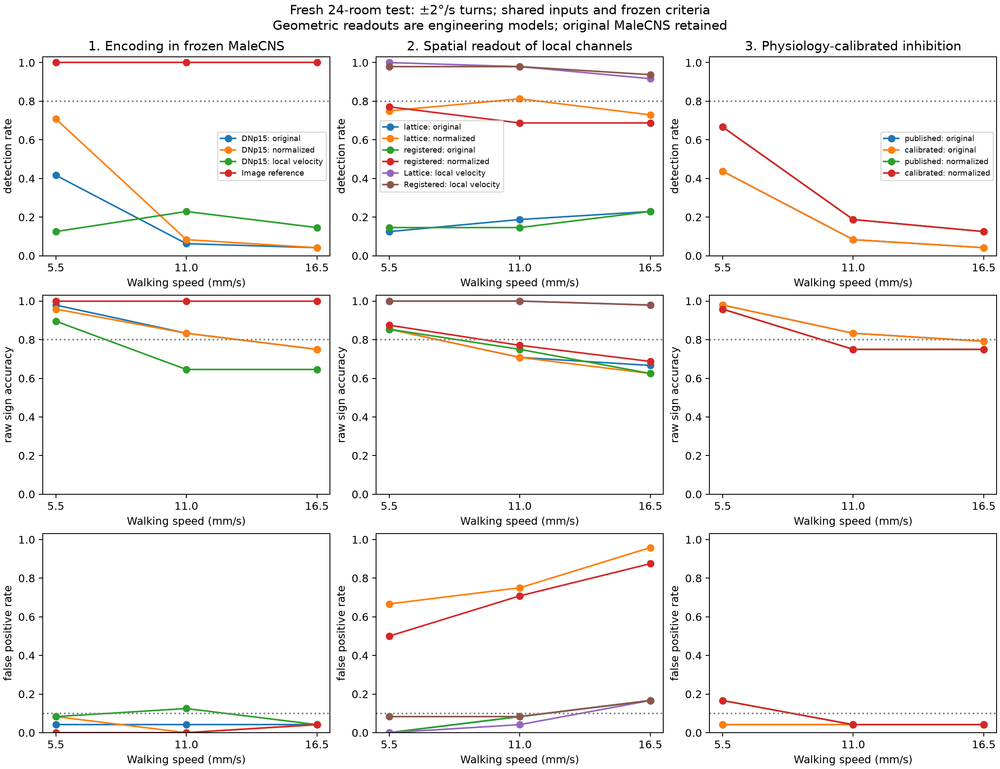

# Three small-turn repair tests and a matched local-motion control

26 October 2026, local project date. **All requested tests were executed. None
of the new neural/circuit candidates meets the complete small-turn target.**
Contrast normalization improves slow-speed DNp15 detection, but not fast-speed
performance. A calibrated inhibitory weight does not change its small-turn
decisions. Spatial readouts of local image-derived velocity detect most turns,
but fail the fast false-alarm requirement. The existing image algorithm passes
on the **same original-resolution retinal movies**, addressing an important
confound in previous comparisons.

This completes the experiments, not the objective of a reliable physiologically
grounded neural detector. Original models, parameters and earlier evidence remain
unchanged. Negative findings and failed numerical gates are retained.

## Shared experiment and frozen decisions

Use 496 primary episodes: 64 training/stationary episodes in four known rooms,
48 straight calibration episodes in 16 other known rooms, and **384 test episodes
in 24 new rooms**. Each test room has a stationary control and all combinations
of 5.5/11/16.5 mm/s with yaw 0/±2/±5°/s. The test seeds are disjoint from earlier
studies. These are new instances of the existing box/sphere/texture family,
not unrestricted natural environments.

Generate binocular images directly at the original ±86°, 1° retinal lattice.
All primary comparisons use identical movies and existing source-cell identities.
Motion starts at 0.5 s; observe [0.70,1.40) s. The retained prefix ends at 1.41 s to
support the image estimator's centered temporal derivative. The original frontend
and neural traces are causal; image-derived controls use 10 ms future data. Prefix
truncation cannot affect earlier causal outputs. Original parameters and all
203,861 chemical edges remain fixed; no electrical conductances or new anatomical
connections are installed.

The three original recipes were frozen at `1d7962d`. Execute their development
in order: frontend → spatial readout → physiology calibration. Freeze all 72
original neural/motif decoders before new test-image generation. The geometric
estimates retain the already specified 1°/s engineering decision boundary. Neural
readouts use the existing standardized ridge decoder, penalty 0.001, trained
separately by speed on four rooms; cutoff is the maximum absolute straight score
in 16 calibration rooms. No neural weight is optimized for walking classification.

Keep the original acceptance criteria: **≥80% detected, ≥80% correct raw direction,
≤10% observed false alarms**, at 2°/s and sustained at 5°/s for each speed. There
are 48 signed turns and 24 straight cases per speed: require at least 39 detections,
39 correct raw signs and at most 2 false alarms. Undetected turns remain in the sign
denominator. A joint detected-and-correct measure is retained only as a diagnostic.

[Protocol](SEQUENTIAL_SMALL_TURN_REPAIRS_PROTOCOL_V1.md),
[initial freeze](../results/sequential_small_turn_repairs_v1/before_calibration.json),
[before fresh test](../results/sequential_small_turn_repairs_v1/before_test.json),
[all primary predictions](../results/sequential_small_turn_repairs_v1/analysis/predictions.json).

## Route 1 — improve local motion encoding

Compare the original functional frontend with a contrast-normalized copy, feeding
two otherwise identical original MaleCNS networks. Divide local channel responses
by local contrast energy, retaining a reference scale determined by independent
standard plaids. Clip to the original normalized input range and preserve clipping
counts. This is an engineering input hypothesis, not calibrated T4/T5 physiology.

Fit four scalar motion-to-velocity conversions using 56 standard movies across two
axes, two contrasts, seven velocities, and calibration/check texture sizes. At
24° wavelength, normalization lowers velocity-calibration RMSE from approximately
3.12°/s to0.020–0.025°/s. At the separate 32° wavelength check, normalized errors
remain **1.67–1.70°/s**. Removing contrast dependence therefore does not make these
responses a generally calibrated local velocity estimate. The failed check was
not used to retune the frozen normalization.

Fresh-room DNp15 at ±2°/s; entries list slow / medium / fast speed:

| Original-graph input | Detected /48 | Correct raw direction /48 | False alarms /24 |
|---|---|---|---|
| Original functional frontend | 20 / 3 / 2 | 47 / 40 / 36 | 1 / 1 / 1 |
| Contrast-normalized frontend | **34 / 4 / 2** | 46 / 40 / 36 | 2 / 0 / 1 |

Slow detection improves by 29.2 percentage points; paired-room bootstrap95% interval
[16.7,41.7] points. This is a planned comparison in a finite test set, without a
claim of population significance across all comparisons. Slow detection remains
below 39/48, and fast detection is unchanged. New baseline counts differ from
earlier reports because the test rooms are new; the original model itself did
not change. All 112 known-room baseline input replays match exactly; rates match
to floating-point precision.

[Standard observations/errors](../results/sequential_small_turn_repairs_v1/calibration/frontend.json),
[all role/speed curves](../results/sequential_small_turn_repairs_v1/analysis/curves.csv),
[paired effects](../results/sequential_small_turn_repairs_v1/analysis/paired_effects.json).

## Route 2 — retain spatial structure

Read horizontal/vertical responses at 330 predefined local sites across the two eyes,
before eye-wide averaging. Test both the virtual functional channel lattice and
a readout restricted to the actual registered source-cell drives. The latter
uses fixed four-neighbor interpolation; every specified site has support.
Apply a geometric projection that cancels ideal forward flow, followed by a
weighted median. Geometry and all weights are fixed before walking outcomes.
No true yaw, depth, walking speed or same-room straight partner enters inference.

This readout assumes that calibrated channel amplitudes can represent local
velocity. The independent texture-size failure limits that assumption. Failure
of this particular readout does not prove that local T4/T5 responses contain
no turn information or exclude a different readout.

| Spatial method | ±2°/s detected /48: slow / medium / fast | False alarms /24 |
|---|---|---|
| Original channel lattice | 6 / 9 / 11 | 0 / 2 / 4 |
| Original registered sources | 7 / 7 / 11 | 0 / 2 / 4 |
| Normalized channel lattice | 36 / 39 / 35 | **16 / 18 / 23** |
| Normalized registered sources | 37 / 33 / 33 | **12 / 17 / 21** |

Normalization produces more alarms, including many straight-walking alarms.
None qualifies. Eye-wide horizontal-only controls, every raw-sign count and
all 5°/s results remain in the full tables. These engineered readouts are not
an anatomically reconstructed bIPS/DNp15 mechanism.

[Source coverage and operator](../results/sequential_small_turn_repairs_v1/source_coverage.json),
[complete spatial results](../results/sequential_small_turn_repairs_v1/analysis/curves.csv).

## Route 3 — calibrate inhibition from recordings

The [Erginkaya et al.2025](https://www.nature.com/articles/s41593-025-01948-9)
study supplies published calcium selectivity measurements and an effective
inhibitory circuit motif. Use its source workbooks already archived locally;
fit only the effective uLPTCrn→bIPS weight, holding all other printed motif weights
fixed. Positive linear observation scaling cancels in the discrimination index
(DI). This assumes the abstract model and measured stimulus selectivity are
comparable; it does not identify membrane or conductance parameters.

The selected calibration target is the median of 22 control bIPS ROIs, Fig4 f.
The inhibitory weight changes **−0.7→−0.7435437361**, matching DI 0.2186533985
within 6.6×10⁻¹¹. Matching the fitted target is expected and is not validation.
Retain the complete 1001-point loss profile and a bounded optimizer check.

| Published measurement | Observed median DI | Model DI | Used for this fit? |
|---|---:|---:|---|
| Control bIPS,22 ROIs | 0.21865 | 0.21865 | Yes |
| Receptor-disrupted bIPS,16 ROIs | −0.08362 | −0.16667 | No |
| DNp15,7 ROIs | −0.68980 | −0.85779 | No |

These are not-fitted checks, not new held-out-animal validation: summaries were
historically available, other published weights were already informed by related
recordings, and all animal identities are not supplied by these ROI columns.
The receptor manipulation also affects more than the one modeled path.

Compare published versus calibrated motifs on identical pooled original or
normalized inputs with the fixed signed-opponent interface. At±2°/s, both motifs
detect **21/4/2**turns with original inputs, and **32/9/6**with normalized inputs.
The physiology calibration changes none of those detection/sign/false-alarm
counts. The normalized motif has 4/24 slow false alarms. None qualifies across
speeds. One scalar selectivity constraint cannot support an invented nonlinear
voltage threshold or electrical conductance; those additions remain unimplemented.

[Calibration, checks and parameters](../results/sequential_small_turn_repairs_v1/calibration/inhibition.json),
[all source ROI values](../results/sequential_small_turn_repairs_v1/calibration/physiology_observations.json),
[loss profile](../results/sequential_small_turn_repairs_v1/calibration/inhibition_loss.npz).

## Additional matched local-velocity encoding control

The standard texture failure and the denser support of the existing image
reference motivated one additional fixed control. Its recipe was frozen before
its development responses and before any new test classifications were scored.
Some original test images already existed. Its 12 decoders were frozen before
its test responses. This addendum does not replace or relabel the original tests.

Compute local Lucas–Kanade velocity from the same images, map it to directional
channels at existing source-cell locations, and feed an unchanged MaleCNS copy.
The scale comes from the already fixed standard-plaid coefficients. **No global
yaw estimate is supplied to the graph.** Both ON/OFF groups receive the local
direction estimate: this is an explicit engineered encoding, not T4/T5 physiology.
Also apply the exact original geometric aggregation at the same lattice sites
and after the same source interpolation, without image-confidence weights.

| Local-velocity method | Detected /48: slow / medium / fast | Correct raw direction /48 | False alarms /24 |
|---|---|---|---|
| Original-graph DNp15 | 6 / 11 / 7 | 43 / 31 / 31 | 2 / 3 / 1 |
| Matched lattice spatial readout | 48 / 47 / 44 | 48 / 48 / 47 | 0 / 1 / **4** |
| Matched registered-source spatial readout | 47 / 47 / 45 | 48 / 48 / 47 | 2 / 2 / **4** |

The registered spatial readout detects most turns, but its fast false-alarm rate
4/24=16.7% exceeds the declared criterion. The original network output remains
unreliable even under this local-velocity encoding. This comparison supports
investigating spatial integration and reliability weighting, while neither
proving a unique biological cause nor establishing a completed repair.

The existing denser, confidence-weighted image median detects **48/48** ±2°/s
turns with 48/48 correct directions at every speed, with false alarms **0/0/1**of 24.
It also qualifies at ±5°/s. Crucially, it consumes the **same 1° primary images** as
the neural models. A useful estimate exists in these tested movies under its
geometric assumptions and future-data allowance. This does not prove identical
information in the original T4/T5 representation or an accurate biological eye.
The matched sparse controls show that support/aggregation also matters.

[Addendum protocol](MATCHED_MOTION_ENCODING_CONTROL_PROTOCOL_V1.md),
[control freeze](../results/sequential_small_turn_repairs_v1/motion_encoding_control/before_development.json),
[before control test](../results/sequential_small_turn_repairs_v1/motion_encoding_control/before_test.json),
[all control curves](../results/sequential_small_turn_repairs_v1/motion_encoding_control/analysis/curves.csv),
[control paired effects](../results/sequential_small_turn_repairs_v1/motion_encoding_control/analysis/paired_effects.json).

## Numerical results, corrections and limitations

Strict C++ and original Python full-prefix replays agree essentially exactly.
All 72 main fits,11,880 main test predictions,198 curves,99 thresholds and all 10,000
paired-room bootstrap draws pass independent reconstruction. The added control
has 12 fits and 2,160 predictions with independent fit/score checks. Four predetermined
fresh-build main cases and four matched-control cases reproduce every retained
array exactly. These are subset replays, not a second complete496-case study.

The ordinary half-step solver check fails. It also changes the legacy code's
input transition from a 1-ms ramp to a 0.5-ms ramp, so it is not a pure integration
comparison. A separate fixed-forcing control preserves the primary 1-ms ramp:
original rate discrepancies are≤2.23×10⁻¹¹, normalized discrepancies≤2.63×10⁻¹⁰.
The latter still **fails** the frozen 10⁻¹⁰ criterion. On these controls its DNp15
score changes by≤2.08×10⁻⁸°/s. The local-velocity graph control also misses that
strict criterion, with rate discrepancies≤2.43×10⁻⁹. Its fixed-readout score
error bounds on the three controls are≤8.76×10⁻⁶°/s. These tiny errors are not
a uniform bound across all test rooms and do not waive failed gates.

Retinal/time refinement fails 0.2°/s gates for normalized lattice/registered HRC
spatial readouts, reaching 0.347°/s. The image reference and both matched local-
velocity spatial readouts pass their specified controls. A full temporal control
halves frontend, source-input and solver clocks; the simpler original temporal
control halves frontend/solver clocks only. Independent geometry checks include
the separated-eye yaw lever arm, and independent image/plaid checks verify local
velocity signs/units. No general physiological or uniform convergence claim is made.

The reproduction launcher corrects alternate-path propagation to spawned workers
without altering frozen primary code. Use it for alternate namespaces; full fresh
execution also requires a clean workspace/input archive because the seed guard
rejects calling already-used test seeds new experiments. No existing evidence
was overwritten. All primary and added-control simulation executions succeeded;
failed calibration/acceptance/numerical gates remain explicitly failed.
The first archival attempt stopped on a missing `pathlib.Path` import before
indexing. Its tool source and partial directory are preserved under
`archive_attempts/attempt_1_missing_import`; the corrected archive tool changes
no numerical result or scientific criterion.

[Main numerical review](../results/sequential_small_turn_repairs_v1/numerical_review.json),
[fixed-forcing control](../results/sequential_small_turn_repairs_v1/fixed_forcing_control/review.json),
[independent statistics](../results/sequential_small_turn_repairs_v1/analysis_review.json),
[main fresh-build replay](../results/sequential_small_turn_repairs_v1/reproduction_review.json),
[matched numerical review](../results/sequential_small_turn_repairs_v1/motion_encoding_control/numerical_review.json),
[matched fresh-build replay](../results/sequential_small_turn_repairs_v1/motion_encoding_control/reproduction_review.json).

Remaining limits include surrogate eye registration, functional rather than
physiological source channels, uncalibrated neural noise and calcium dynamics,
restricted static scene family, speed-conditioned neural decoders,0.7-s averaging,
and future frames in image-derived controls. Zero false alarms in 24 rooms still
has an approximately 13.8% upper 95% Wilson bound; observed-count success is not a
population guarantee. All conditions share 24 test rooms. Bootstrap intervals are
descriptive and do not establish biological causality or account for every
multiple comparison. No closed-loop control or physical deployment was performed.

## Reproduction and archive

Code: [driver](../scripts/sequential_small_turn_repairs_v1.py),
[independent reviewers/replay](../scripts/review_sequential_small_turn_repairs_v1.py),
[path-aware launcher](../scripts/launch_sequential_small_turn_repairs_v1.py),
[matched-control driver](../scripts/matched_motion_encoding_control_v1.py),
[matched-control reviewer](../scripts/review_matched_motion_encoding_control_v1.py).

Use the existing Linux CPU Python environment with PYTHONPATH=src:scripts,
OPENBLAS_NUM_THREADS=1, OMP_NUM_THREADS=1, and NumPy/SciPy/openpyxl/matplotlib.
The archive preserves source snapshots and the exact original graph inputs.
Main stage order is prepare,calibrate_frontend,development,route1,route2,
calibrate_inhibition,freeze_test,held_out,score; controls and independent reviews
are separate. The matched-control order is freeze,development,train,held_out,
controls,score/numerics/reproduce. Do not rerun exclusive writers into completed
directories. Fresh replay requires a fresh namespace; the saved receipts state
which subset was actually repeated.

[Completion](../results/sequential_small_turn_repairs_v1/completion_v1/completion.json),
[artifact index](../results/sequential_small_turn_repairs_v1/completion_v1/artifact_index.json),
[post-exit verification](../results/sequential_small_turn_repairs_postseal_v1.json).

## What we did, what we want, and why — undergraduate explanation

We want the brain model to notice a small accidental turn while the fly walks
forward. We tested clearer motion inputs, keeping local motion patterns separate,
and adjusting inhibition using published recordings. Clearer inputs help at slow
walking, but the brain model still misses most fast-walking turns. A spatial
readout catches many more turns, although it sometimes mistakes straight walking
for a turn. A separate image algorithm succeeds on exactly the same pictures.
The useful new result is that the pictures can support the task; these tested
neural computations do not yet solve it. Further work should target reliable
spatial separation of walking and turning, with physiological evidence guiding
any claimed biological implementation.
