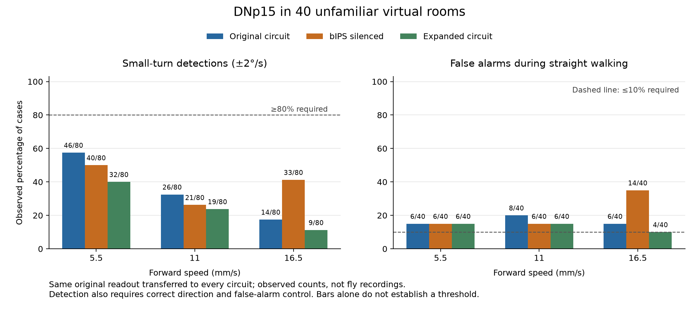

# Yaw detection and bIPS: consolidated evidence V1

24 October 2026, America/Belem. Retrospective synthesis of Studies A/B and the
later independent-environment/convergence study. No model, decoder or acceptance
criterion was changed. [Short professor summary](PROFESSOR_YAW_BIPS_SUMMARY_V1.md).

**Scientific answer:** these predefined readouts do not establish reliable small
yaw detection across walking speeds and unfamiliar environments. bIPS affects
DNp15 gain and left–right balance within the model; its contribution is not a
uniform improvement in detection, and yaw-dependent signals remain without it.
These are useful computational findings and experimental hypotheses. They do
not establish a fly's detection threshold or biological causality.

## The question and the evidence hierarchy

Yaw means turning about the vertical axis. Forward motion and yaw both produce
image motion. We asked whether the modeled circuit separates them, rather than
merely responding strongly to visual movement. HS, H2, bIPS and DNp15 are neuron
classes/families, represented on both sides of the model. They are not four brain
regions. The visual-only model receives no motor-intention signal; identifying
rotation does not identify whether that turn was intended.

Study A used the frozen circuit and twelve graph copies, including selective
bIPS-output and HS/H2 controls. Study B added recorded chemical circuitry from
17 uLPTCrn and eight H2rn candidate homologs, with identification qualifications.
The later study added 40 held-out rooms and a complete sampling-profile sweep.
Its stronger tests qualify the earlier six-room results; each original report
and artifact remains preserved. [Study A](YAW_SENSITIVITY_ABLATION_REPORT_V1.md),
[Study B](ANATOMICAL_STRENGTHENING_REPORT_V1.md),
[later generalization/convergence](VALIDATION_GENERALIZATION_CONVERGENCE_REPORT_V1.md).

Each room has 33 walking conditions: three forward speeds (5.5, 11, 16.5 mm/s)
crossed with eleven yaw velocities (0, ±2, ±5, ±10, ±20, ±40°/s), plus a stationary
control. Those are 34 visual conditions per room. Circuit copies, rooms and
sampling profiles are additional comparisons, not additional yaw velocities.
Readouts use mean left/right class responses over 70 samples (0.70–1.39 s) and
are told the walking speed. Training and cutoff calibration use separate
development rooms; held-out rooms enter neither operation. These are finite
deterministic scene tests rather than noisy neural trials or independent flies.

The frozen threshold rule requires at least 80% detection and 80% raw yaw-sign
accuracy, with at most 10% observed straight-walking false alarms, at a magnitude
and every larger tested magnitude. Sign accuracy includes nondetections. A
failed false-alarm criterion makes a threshold unresolved; it does not establish
a physical lower bound or absence of yaw information elsewhere in the circuit.

## What the original circuit detects

In the 40 unfamiliar rooms, the unchanged DNp15 readout gives:

| Forward speed | ±2°/s turns detected | Correct sign at ±2°/s | Straight false alarms | Qualifying threshold |
|---:|---:|---:|---:|---|
| 5.5 mm/s | 46/80 (57.5%) | 72/80 (90%) | 6/40 (15%) | Unresolved |
| 11 mm/s | 26/80 (32.5%) | 60/80 (75%) | 8/40 (20%) | Unresolved |
| 16.5 mm/s | 14/80 (17.5%) | 52/80 (65%) | 6/40 (15%) | Unresolved |

At ±5°/s, detection is 78/80, 54/80 and 29/80; at ±20°/s it is 80/80,
80/80 and 79/80. Larger turns evoke more detectable signals, but straight-control
failures prevent qualifying original DNp15 thresholds even then. The 95% Wilson
intervals for 6/40 and 8/40 false alarms are approximately 7.1–29.1% and
10.5–34.8%. Observed rates and intervals are properties of the sampled rooms,
not biological sensitivity estimates.

Original HS and bIPS also have unresolved transferred-readout thresholds at all
three speeds. H2 qualifies at 20°/s at 5.5 mm/s with 4/40 false alarms, exactly
the allowed observed limit; it fails false-alarm control at faster speeds.
This result does not support a universal failure of every class at every speed.
[Audited DNp15 counts](../results/yaw_bips_evidence_synthesis_v1/dnp15_generalization.csv),
[all four groups and decoder modes](../results/yaw_bips_evidence_synthesis_v1/all_group_generalization_thresholds.csv).

The figure shows observed counts with the same original readout transferred to
each circuit. Read both panels together: more reported turns can coincide with
more false alarms. It is not a biological recording or a population guarantee.

## What bIPS contributes

With the DNp15 readout fixed, bilateral bIPS-output suppression changes straight
false alarms as follows:

| Forward speed | Intact | bIPS suppressed |
|---:|---:|---:|
| 5.5 mm/s | 6/40 | 6/40 |
| 11 mm/s | 8/40 | 6/40 |
| 16.5 mm/s | 6/40 | 14/40 |

At fast walking, suppression increases ±2°/s detections from 14/80 to 33/80, but
reduces correct signs from 52/80 to 45/80 and increases false alarms. Counting
the detection increase alone would therefore misrepresent improvement.

Paired descriptive response analysis shows that fast-walking odd DNp15 asymmetry
after suppression is 0.8566 times intact at ±2°/s: about a 14% reduction. Straight
asymmetry shifts by +3.84×10⁻⁵ signed model units. Here asymmetry is left minus
right, and the odd component is half its difference between positive and negative
yaw. These are post-score diagnostics conditional on the original rendering
profile, not frozen acceptance criteria or calibrated firing-rate/calcium changes.
[All paired effects](../results/yaw_bips_evidence_synthesis_v1/bips_and_added_family_response_effects.csv).

Study A's selective lesions help localize this effect within its equations:
removing only bIPS→DNp15 raised fast straight false alarms from 0/6 to 3/6;
bilateral suppression raised them to 4/6. Removing bIPS→HS, bIPS→H2 or bIPS
recurrence retained the original 20°/s grid result. Recalibrating on each lesion's
development rooms recovered that fast threshold after bilateral or direct-output
suppression. Thus the evidence supports shaping gain and the original response
balance, without establishing indispensable yaw information. These six-room
findings inherit the sampling limitation below. HS/H2 interventions and the
opposite effects of unilateral bIPS lesions also depended on readout calibration.
[All original DNp15 interventions](../results/yaw_bips_evidence_synthesis_v1/study_a_dnp15_lesions.csv).

## Findings that limit the earlier interpretation

The original fast-walking 20°/s threshold had zero false alarms in six historical
rooms at 1° panorama pitch. Keeping the circuit and transferred decoder unchanged
gave 2/6 at 0.5°, 3/6 at 0.25°, and 2/6 at 0.25° with finer time steps. Each
refined threshold is unresolved. The broader sweep retained 3,998/4,896 mean and
4,270/4,896 contrast flags above the original 10% numerical-change rule, plus
701 changed decisions in 19,008 comparisons. These counts cover multiple copies,
roles and decoder modes, not independent biological trials. Agreement between
implementations does not establish insensitivity to image sampling.
[Sampling comparisons](../results/yaw_bips_evidence_synthesis_v1/historical_dnp15_sampling.csv).

The expanded circuit has one qualifying transferred DNp15 result in the new
rooms: 20°/s at fast walking, with 4/40 false alarms. Its 95% false-alarm interval
is approximately 4.0–23.1%, and ±2°/s detection is only 9/80. Silencing the added
families changes false alarms to 5/40, losing that qualification. Development-only
readout retraining does not consistently solve generalization. This single-room
cutoff difference does not establish a robust anatomical improvement. Adding
nodes also changes inherited incoming-weight normalization; silencing them
retains that scaling. Neither smaller response amplitudes nor added synapse
counts alone establish a better physiological model.

## What biological evidence is needed next

Published experiments support recurrent inhibition and lateral disinhibition in
rotation-versus-translation processing. Their DNp15 GABA-A manipulation affects
multiple inhibitory sources; recording DNp15 during bIPS-specific TNT suppression
was prevented by an expression problem. Our idealized bIPS lesion is therefore
a testable model hypothesis rather than reproduction of that measurement.
[Erginkaya et al. (2025), Fig. 5 and Methods](https://www.nature.com/articles/s41593-025-01948-9).

| Evidence priority | Specific missing evidence | What it would resolve |
|---|---|---|
| Match visual input to recordings | Source-supported display geometry, actual frames/refresh or a fully specified generator, contrast, optical sampling and world CW/CCW convention | Whether the model and fly saw the same stimulus, including small yaw |
| Match model activity to measurements | Verified left/right cell and imaged neurite identity, reporter/voltage metadata, baseline/noise and response dynamics; calibration flies kept separate from fresh validation flies | Whether the model predicts the recorded response rather than an arbitrary proxy |
| Test the bIPS hypothesis | Bilateral DNp15 recordings during forward-only and forward-plus-yaw conditions, with verified bIPS-output perturbation and matched controls where experimentally feasible | Whether perturbation shifts the straight baseline, yaw response gain, or both; the model predicts separable effects |
| Constrain omitted physiology | Evidence for electrical coupling with justified strengths/dynamics, and matched walking-state/nonvisual inputs | Which missing mechanisms can be incorporated without inventing connections or optimizing yaw accuracy |

Electrical interactions in the HS–H2 system have experimental support; zero gap
entries in our circuit indicate missing constraints. HS also receives nonvisual
walking-related signals. Neither mechanism is supplied by visual replay alone.
[Pokusaeva et al. (2024)](https://www.nature.com/articles/s41467-024-53173-w),
[Fujiwara et al. (2017)](https://pubmed.ncbi.nlm.nih.gov/27798632/).

Published data and analysis code already support useful diagnostic work.
Existing corrected calcium comparisons nevertheless bypass images, reuse
previously inspected test flies and retain measurement/sign gaps. Their numerical
agreement cannot validate this complete image-to-neuron pathway.
[Corrected diagnostics](CORRECTED_PHYSIOLOGICAL_DIAGNOSTICS_REPORT_V2.md),
[dataset inventory](ANATOMICAL_STRENGTHENING_DATASET_MAP_V1.md).

The recommended next bounded task is to diagnose the spatial-sampling dependency
on fixed existing conditions before selecting a final stimulus representation.
Then freeze one source-matched image-to-recording comparison, with measurement
calibration separated from independent validation. If metadata or fresh animals
are unavailable, report that gate rather than reinterpret old diagnostics as
validation. These are proposed priorities, not new experiments executed here.

## What was checked for this synthesis

A new stdlib-only audit reconstructed all **122,232 saved prediction decisions,
6,540 curve rows and 1,308 threshold rows** across A, B and the extension. All
match the saved tables. It also reconstructed 30 descriptive response summaries
from all 1,200 paired-room rows and recounted all refinement flags/changes. It
verified 26 selected source files against earlier recorded hashes in three
component indexes and the physiological report's separate provenance ledger.
That ledger is distinguished from a component seal; this is not a complete
rehash of every predecessor artifact or a new solver/biological validation.
[Audit](../results/yaw_bips_evidence_synthesis_v1/review.json),
[source integrity](../results/yaw_bips_evidence_synthesis_v1/source_verification.json),
[all reconstructed thresholds](../results/yaw_bips_evidence_synthesis_v1/all_reconstructed_thresholds.csv),
[methods](YAW_BIPS_SYNTHESIS_METHODS_V1.md).

Reproduce into a new output directory with
`python scripts/summarize_yaw_bips_evidence_v1.py --out results/yaw_bips_synthesis_reproduction_YYYYMMDD`.
The script refuses existing destinations. The V2 figure script uses the authoritative
V1 audit and refuses an existing presentation directory. Presentation V1 is
preserved; V2 moves an overlapping limit label and reduces count-label size.
Earlier reports/results
and the unfinished V9 timing benchmark remain preserved. CPU execution is a
separate engineering output and does not change these scientific conclusions.

## Undergraduate explanation: what we did, what we want and why

We want to understand how a fly notices a turn while moving forward. We showed
a computer model the views from a walking fly's two eyes, changed selected parts
of its circuit, and tested unfamiliar rooms and finer images. The model responds
to turns, and bIPS changes the strength and balance of that response. However,
the model still reports some turns during straight walking, and an earlier
sensitivity result changes with image sampling. We have therefore learned which
claims are supported and which need more work. Next we need stable visual inputs
and fair comparisons with recordings from real flies. That gives us a scientific
basis for improving the model and, eventually, deciding whether it can help a
robot recognize unwanted turns.
