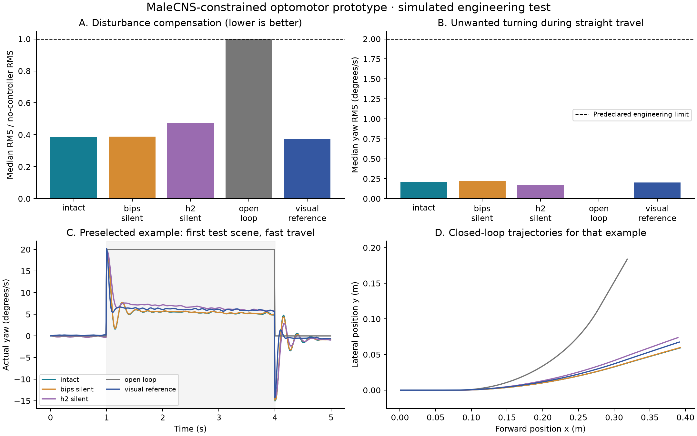

# Closed-loop optomotor prototype V1

16 November 2026

Engineering feasibility: **FAIL**. Biological validation and physical-robot testing were not performed.

The experiment closes the visual feedback loop: camera images drive motion-sensitive source populations, real MaleCNS chemical counts constrain a recurrent central circuit, and the left/right DNp15 difference controls a simulated motor. Motor sign and gain were calibrated in separate scenes before test outcomes.

Evaluated 270 episodes across 6 held-out synthetic scenes, three speeds, both disturbance signs and straight controls. Ablations reuse intact motor calibration and normalization.

| Mode | Median disturbance RMS / open loop | Cases improved | Median straight yaw RMS (deg/s) |
|---|---:|---:|---:|
| intact | 0.3864 | 36/36 | 0.2063 |
| bips_silent | 0.3883 | 36/36 | 0.2203 |
| h2_silent | 0.4731 | 36/36 | 0.1741 |
| open_loop | 1.0000 | 0/36 | 0.0000 |
| visual_reference | 0.3754 | 36/36 | 0.2041 |

## Predeclared gates

- median_improvement_both_directions: True
- median_straight_rms_within_limit: True
- half_step_rms_change_at_most_5_percent: False

## Limits

- Synthetic planar scenes and noiseless equatorial camera
- Functional pooled T4/T5 source drive
- Clamped T4/T5 excludes their recurrence and central feedback
- Transmitter signs and rate dynamics assumed
- Motor sign/gain calibrated in simulation
- No recording comparison or animal-level validation

An ablation effect is a property of this model and fixed motor calibration, not evidence that a cell class is biologically necessary. Inspect all per-case outcomes and numerical refinements in summary.json and episodes.csv.

A velocity reflex reduces rotation; this implementation has no heading setpoint and need not return to the original heading after a disturbance.

